# Nuvik Vet — Logical Database Design

**Status:** design proposal; not executable DDL. This document does not authorize migrations or startup. It describes a tenant-aware veterinary clinic platform with clinical care, boarding, inventory, sales, and finance. `docs/MIGRATION_AUDIT.md` records why inherited Human Clinic SQL is not the target schema; `docs/DATABASE_DECISIONS.md` records decisions and questions still requiring product/accounting approval.

## Design invariants

1. Every operational row belongs to exactly one clinic (`tenant_id`). Rows with a physical or operational branch context also carry `branch_id`. Cross-tenant references are rejected by the database, not merely filtered in application code.
2. Posted clinical, inventory, and financial history is append-only or corrected with explicit reversal/superseding rows. Drafts may be edited under their lifecycle rules.
3. One domain event creates at most one receivable source posting. Retries are idempotent.
4. A balance or current-state table is a projection; its source events and a reconciliation path are retained.
5. Local PostgreSQL initialization never runs application migrations implicitly.

## Tenant, branch, users, and reference data

- `clinics` is the tenant root; `branches` has `(tenant_id, id)` uniqueness and belongs to one clinic. `users` represents login identities. `clinic_memberships` joins users to a tenant; branch-scoped access is represented by membership/role scope or a branch membership relation. `roles`, `permissions`, `role_permissions`, and scoped `membership_roles` provide authorization. Do not encode authorization in a single role string.
- Every tenant-owned table has `tenant_id`. Every branch-scoped transaction/record has `branch_id` as well. For a tenant-wide object such as an owner or catalog item, branch may be absent; branch-specific configuration and all branch transactions require it.
- Enforce tenant consistency with alternate unique keys such as `(tenant_id, id)` and composite FKs `(tenant_id, referenced_id)`. For branch-scoped links, use `(tenant_id, branch_id, id)` keys where necessary, or reference `(tenant_id, branch_id)` and the row's scoped key. A child may not refer to a customer, animal, provider, product, invoice, or location from another tenant. A branch-level transaction may reference a tenant-wide object of that same tenant. Do not rely on a plain UUID FK plus application validation.
- Prefer `RESTRICT` for historical clinical, stock, financial, and audit references. Deactivation/archival replaces deletion where history exists.
- Global immutable reference data may include species and standardized diagnosis/vaccine/medication codes. Tenant-specific rows include breeds/custom labels, clinic-specific service/product catalog, price lists, roles, settings, and inventory. Model global references as nullable-tenant or a separate global table; tenant overrides refer to a global row without copying its identity. Explicitly define which vocabularies may be extended locally.
- Unique constraints include `(tenant_id, normalized_email)` where tenant-local identity is intended, `(tenant_id, sku)`, and tenant-scoped external identifiers. Global reference code uniqueness is global; tenant-owned codes are scoped to tenant.

## Owners and animals — authoritative ownership model

`animal_owners` is the **only authoritative ownership relation**. Do not also store `animals.primary_owner_id`: duplicated ownership state can disagree. Each row contains `(tenant_id, animal_id, owner_customer_id, valid_from, valid_to, is_primary, relationship, created_by, created_at, ended_by, ended_at)`. `customers` is the owner/contact entity; `animals` is the veterinary subject. A customer may own many animals and an animal may have multiple current owners.

- Exactly one current primary owner is required for every active animal. Enforce one primary row per animal with a partial unique constraint/index on `(tenant_id, animal_id)` where `is_primary AND valid_to IS NULL`. Enforce that a current ownership row exists and that each current animal has exactly one primary through a transactionally enforced DB mechanism (e.g. deferred constraint trigger) or a single controlled ownership command plus a database validation constraint. A simple partial unique index guarantees **at most one**, not existence; this distinction must not be lost in implementation.
- Ownership periods use half-open intervals `[valid_from, valid_to)`. Reject invalid ranges and overlapping rows for the same animal/customer pair; do not permit two simultaneous primary owners. Transfer/shared-owner updates run atomically: close old periods, add new owner rows, and set exactly one primary before commit. Historical rows remain immutable after closure except audited correction.
- Shared ownership is represented by multiple current `animal_owners` rows, with exactly one marked primary. Define contact/billing authority separately from ownership (e.g. explicit `is_contact` and `billing_responsible` flags with appropriate uniqueness/rules); do not infer legal authority from primary status.
- `animals` holds identifiers, species, optional breed, birth-date certainty, sex/reproductive status, lifecycle status, and tenant identity. Dated weights/body-condition measurements live in `animal_measurements`; do not overwrite longitudinal measurements on the animal row. Protect microchip/identifier uniqueness within agreed tenant/global policy.

## Veterinary records

- `appointments` link tenant, branch, animal, optional provider, time zone/interval, status, and optional owner contact. A completed visit is a `consultation` (encounter), optionally linked one-to-one to an appointment; walk-ins may have no appointment. Appointment transitions are explicit and audited.
- `consultations` record animal, branch, start/end, provider, author, status, narrative, and provenance. `consultation_observations` contain a controlled `observation_code`/concept, typed value, unit, observed time, method, reference range/context and author. Use mutually exclusive typed columns or a validated typed-value representation (`value_numeric`, `value_boolean`, `value_text`, `value_code`) with a check that exactly the correct value is populated for `value_type`. Numeric values carry UCUM-compatible `unit_code`; never store temperature, weight, pulse or pressure as untyped text. Preserve original value/unit if conversion is needed. Common vital observations may be promoted to typed columns only if their unit and species semantics are explicit.
- `diagnoses` is global/tenant-extensible terminology; `consultation_diagnoses` links diagnosis to encounter with status, primary flag, certainty and author. Enforce at most one primary diagnosis per encounter; allow zero if not yet assessed.
- `medications` is a tenant-aware catalog (generic/brand, strength, form, route, concentration, active substance and controlled-drug metadata as applicable). Distinguish a medication concept from `product_variants`/dispensable stock item; a medication catalog entry may map to one or more sellable products. `prescriptions` link animal, consultation, prescriber and status. `prescription_items` store medication/product reference, prescribed dose, dose unit, route, frequency, duration, quantity, refills, instructions, and start/stop dates. Keep dose units and frequency structured while retaining human-readable directions. Tenant composite FKs protect encounter, animal, prescriber and catalog references.
- `dispensations` and `dispensation_items` record actual supplied quantity, dispenser, time, product/lot/location and prescription item. Posting a dispensation is a transaction that creates the inventory issue movement; a prescription alone never changes stock. Reversals use linked correction movements and dispensing corrections, not edits to posted rows.
- `vaccines`/`vaccine_products` identify vaccine, target/disease and dose protocol; `vaccine_batches` track lot/batch, expiry, manufacturer and received product/location. `vaccination_administrations` records animal, vaccine, exact batch, administered dose, route/site, date/time, administering user, prescribing/authorizing clinician, consultation, adverse reaction and source location. `next_due_at` (and any due rule/version) is captured on administration as the recommendation made at that time; `vaccination_reminders`/`vaccination_schedule_items` represent future plans separately. Do not treat a schedule/reminder as proof of administration. Tenant/branch and lot FKs must agree.
- `clinical_admissions` represent inpatient medical hospitalization, with admit/discharge times, reason, responsible clinician, status and care plan. `hospitalization_observations` (or a common clinical observation linked to admission) record timestamped vitals/notes and author. `monitoring_plans` and `monitoring_tasks` define due checks; `monitoring_records` record completion, values, missed checks and escalation. Hospitalization is distinct from commercial boarding, even when both allocate a physical accommodation; any shared resource allocation must avoid double booking.
- Clinical files/attachments are private records with explicit tenant and parent links, storage metadata, access control, and retention rules. Do not expose permanent public prescription or medical file URLs.

## Boarding

- `accommodation_types` define species/size/feature compatibility and default policy. `accommodations` are branch-owned units (room, kennel, run, cage, or shared ward) with capacity, active status, compatible species and optional rate plan. Capacity is positive. `allocation_mode` distinguishes `exclusive` (one animal/reservation occupies the full unit) from `shared` (several compatible animals may occupy up to capacity). Model shared occupancy using `boarding_allocations(reservation_id, accommodation_id, animal_id, occupied_from, occupied_to, capacity_units)` so capacity consumption is explicit; an exclusive unit consumes full capacity. Do not assume a room is exclusive merely because it has one row.
- `boarding_reservations` belong to one tenant/branch and animal, with requested/confirmed/check-in/check-out/cancelled/no-show status, planned and actual interval, owner/contact, rate-plan/price snapshot, and cancellation reason. Use timestamps with time zone and half-open interval `[check_in, check_out)`; require planned end after start, actual checkout after check-in, and timezone-aware branch presentation. Prevent overlapping exclusive allocations and enforce shared-capacity limits transactionally under locks (an exclusion constraint can address overlap but not aggregate capacity by itself). A UI availability check is not sufficient. Define whether cleaning/turnover buffers occupy capacity as part of allocation intervals.
- Reservation transitions and check-in/out are audited. Cancelled/no-show reservations release future allocations according to policy; actual stay dates remain recorded. A reservation is not a clinical admission.
- `boarding_care_plans`, `care_tasks`, `care_task_completions`, `feeding_events`, `boarding_medication_administrations`, `boarding_observations`, and `boarding_incidents` record daily care. Tasks have due window, assigned user, instructions, status, completion time and performer; completion captures actual food/quantity, medication/dose/route and prescription where applicable, observation code/typed value/unit, incident severity/actions and notes. All events link reservation/animal and tenant/branch and are time-stamped. Medication administration links to its prescription and is distinct from dispensing; stock is reduced only for a separately posted dispense/issue event. Missed tasks and incidents are immutable auditable events.
- `boarding_rate_plans` and effective-dated `boarding_rates` define price by accommodation type/branch, occupancy unit, animal size/species, day/night/hour, season and optional services. Reservation confirmation snapshots currency, rate, billable units, discounts/tax and rule version. Define rounding and day-boundary/grace policy before implementation; later rate changes never rewrite confirmed or posted charges. Posted charges flow once into a receivable source line.

## Inventory and purchasing

- `products`/`product_variants` define sellable/serviceable catalog; `inventory_locations` are branch-scoped; `inventory_lots` identify product variant, tenant, lot/batch, supplier/manufacturer, received/expiry dates and status. Lot tracking may be optional by product policy, but expiry-controlled or regulated items must require a lot. A lot may not be used across products, tenants, or locations outside an explicit transfer.
- `stock_movements` is the immutable **source of inventory history**. Each posted movement has tenant/branch, product variant, location, optional lot, signed base-unit quantity, movement type, effective/posted time, actor, source event and unique idempotency/posting identity. Transfers create paired out/in movements linked by a transfer ID; adjustments reference a counted quantity and reason. Corrections append a compensating movement referencing the original; never update/delete posted movement rows. Enforce positive quantity magnitude with direction/type constraints, valid product/lot/location scope, and uniqueness `(tenant_id, posting_source_type, posting_source_id, posting_line_id, movement_kind)` or a dedicated immutable posting key to prevent duplicate inventory postings.
- `stock_balances` is a **transactionally maintained projection**, not an authority. Unique key: `(tenant_id, branch_id, location_id, product_variant_id, lot_id)` (with a defined sentinel/NULL uniqueness strategy for untracked stock). In the same DB transaction that inserts movements, lock/upsert each affected balance and apply the delta. Reject negative on-hand/available stock unless a specific tenant policy allows backorders. Reserve quantities separately (`stock_reservations`) or compute available as on-hand less active reservations; define which model is used before sales implementation. Never allow callers to write balance directly.
- For posting: begin transaction; acquire locks in deterministic key order for affected balance/lot rows; validate tenant, branch, lot expiry, unit conversion and available quantity; insert unique business posting and movement rows; update projection; commit. Retries use an idempotency key scoped to tenant and operation, with request hash/result so same key/same request returns prior result and same key/different request is rejected. Movement uniqueness is a second guard. Sale, dispense, return, receipt, spoilage and transfer source posting plus their movements are atomic.
- Reconciliation recomputes balance from movement sums by the full key, compares projection and reservations, records discrepancy and initiator in an audit/reconciliation record, and repairs only through a controlled transaction plus explicit adjustment movements. Do not silently overwrite the projection to hide a discrepancy. Periodic and on-demand reconciliation must be supported.
- `suppliers`, `purchase_orders`, `purchase_order_items`, `goods_receipts`, and receipt items record ordered vs received quantities, costs, lot/expiry and location. Receiving is a posted event that creates stock movements exactly once. Purchase returns similarly create linked outbound movements and financial credit events.

## Sales, receivables, payments, returns, and finance

- `sales` and `sale_items` are the POS source business transaction; `invoices` and `invoice_lines` are receivable documents. They are related but not interchangeable. A sale may be paid immediately (a receipt/settlement with no open receivable) or posted to one invoice. If invoiced, the sale has one unique receivable posting/invoice link and invoice lines reference sale lines. Enforce at most one receivable source posting per business source line with a unique `(tenant_id, source_type, source_id, source_line_id)` key. Retrying sale finalization cannot create duplicate invoice lines or receivables. Non-POS clinic/boarding charges likewise have a unique source-event key. One source line may not be invoiced twice, even across multiple invoices, unless it is explicitly split into uniquely identified charge components.
- `invoices` store tenant/branch, customer, currency, issue/due dates, status, immutable totals/snapshots and source. `invoice_lines` store source domain/event, product/service/boarding description snapshots, quantity, unit amount, discounts, tax basis/rate/amount, and line total. Source foreign keys should be explicit where practical; if polymorphic, retain a typed source registry with uniqueness and integrity validation rather than unconstrained string/UUID pairs. Draft invoice edits are allowed; posted invoices are immutable except approved credit/debit adjustment documents.
- `payments` represent captured tender/receipts (provider reference, method, amount, currency, status, captured time, actor). `payment_allocations` link a captured payment to invoice(s), with amount and immutable allocation identity. Permit partial payment and (only if approved) unapplied customer credit. In one transaction lock payment and invoice, check tenant/currency/outstanding rules, insert unique allocation and update any derived totals/projection. Enforce allocations do not exceed captured payment or invoice receivable unless an explicitly modeled credit/refund workflow allows it.
- Idempotency keys are unique by tenant and operation for sale finalization, invoice/source posting, payment capture, allocation, refund, and return. Persist request hash and outcome; reject key reuse with different input. Also use unique external processor reference scoped to processor/merchant account. Posting keys protect retries beyond API process memory.
- `refunds` reverse a payment capture, not an invoice balance directly; they reference original payment and optionally allocations, amount, reason, currency, actor, provider reference and state. Enforce cumulative successful refunds <= captured payment, accounting for prior refunds, under row locks. A refund changes allocations/receivable through explicit reversal entries and may leave an invoice amount due; never erase original payment.
- `returns`/`return_items` reference the original sale and sale lines, capture reason, restock disposition/location/lot and refund/credit outcome. Lock original sale line and enforce cumulative accepted return quantity <= net sold quantity after prior returns. A sellable return appends stock-in movement; damaged/disposed goods use separate disposition movements. The financial credit/refund and stock return are atomically linked to one return posting; no duplicate credit for retries.
- Financial corrections are append-only: void a draft; for posted documents issue a linked credit note/debit note or reversal and replacement, preserving original, reason, actor, approver and timestamps. Do not edit posted totals or delete finance rows. Separate preparer/approver for material corrections where policy requires. `financial_audit_events` capture operation and references without storing secrets/payment credentials; general `audit_events` cover all domains. Reconcile invoice lines to document totals, allocations to payment totals, refunds to captures, and ledger/projection totals. Any denormalized `paid_amount`/`balance_due` is a transactionally maintained projection with reconciliation, not independent truth.
- `expenses`, expense categories, tax configuration, cash sessions/closings, and (if required) commissions are tenant/branch-scoped, posted immutably, and corrected through reversal. Currency uses explicit ISO code and a defined scale/minor-unit policy; tax jurisdiction/rule snapshots are retained. Accounting policies (recognition, tax, cash close, commission basis) require owner/accountant approval before implementation.

## Audit and privacy

`audit_events` contain tenant, optional branch, actor, action, entity type/id, event time, request/correlation ID, outcome, and minimal redacted before/after or changed-field metadata. Enforce tenant-scoped entity references where possible; use a constrained entity registry if a polymorphic target is required. Append-only permissions; restrict medical detail and never log passwords, tokens, secrets, or unnecessary sensitive notes. Define retention/access policy for clinical and financial records.

## Constraints, concurrency, and data types

Use UUID or another consistent key strategy; money uses fixed-scale decimal or integer minor units with explicit currency. Quantities/doses use explicit base and presentation units with controlled conversion. Use `timestamptz` for instants, date for local business dates, and store branch timezone separately. Add checks for positive dimensions, valid intervals, enum/status transitions where feasible, and nonnegative amounts. Index tenant-leading access paths and common `(tenant_id, branch_id, status, time)` filters. Use `RESTRICT` for posted history. Appointment overlaps, ownership periods, exclusive boarding allocations, shared capacity, payment allocations and stock must be serialized/locked in transactions; application prechecks alone do not provide integrity.

## Mermaid ER diagram

The diagram shows principal relationships only; all tenant-owned tables shown below carry `tenant_id`, and branch-scoped tables also carry `branch_id`. Composite tenant/branch foreign keys are required even where Mermaid omits key columns. Global reference tables may omit tenant keys; tenant overrides remain scoped.

```mermaid
erDiagram
  CLINIC ||--|{ BRANCH : operates
  USER ||--o{ CLINIC_MEMBERSHIP : joins
  CLINIC ||--|{ CLINIC_MEMBERSHIP : grants
  CLINIC_MEMBERSHIP ||--o{ MEMBERSHIP_ROLE : receives
  ROLE ||--o{ MEMBERSHIP_ROLE : assigned
  ROLE ||--o{ ROLE_PERMISSION : grants
  PERMISSION ||--o{ ROLE_PERMISSION : included
  CLINIC ||--o{ CUSTOMER : registers
  CUSTOMER ||--o{ ANIMAL_OWNER : owns
  ANIMAL ||--|{ ANIMAL_OWNER : ownership_history
  SPECIES ||--o{ ANIMAL : classifies
  BREED o|--o{ ANIMAL : describes
  ANIMAL ||--o{ ANIMAL_MEASUREMENT : measured
  BRANCH ||--o{ APPOINTMENT : hosts
  ANIMAL ||--o{ APPOINTMENT : booked
  USER o|--o{ APPOINTMENT : provider
  APPOINTMENT o|--o| CONSULTATION : results_in
  ANIMAL ||--o{ CONSULTATION : examined
  USER ||--o{ CONSULTATION : authors
  CONSULTATION ||--o{ CONSULTATION_OBSERVATION : records
  OBSERVATION_CONCEPT ||--o{ CONSULTATION_OBSERVATION : types
  CONSULTATION ||--o{ CONSULTATION_DIAGNOSIS : diagnoses
  DIAGNOSIS ||--o{ CONSULTATION_DIAGNOSIS : coded
  CONSULTATION ||--o{ PRESCRIPTION : issues
  PRESCRIPTION ||--|{ PRESCRIPTION_ITEM : contains
  MEDICATION ||--o{ PRESCRIPTION_ITEM : prescribed
  PRESCRIPTION_ITEM ||--o{ DISPENSATION_ITEM : supplied
  DISPENSATION ||--|{ DISPENSATION_ITEM : contains
  VACCINE ||--o{ VACCINE_BATCH : has_batch
  ANIMAL ||--o{ VACCINATION_ADMINISTRATION : receives
  VACCINE_BATCH ||--o{ VACCINATION_ADMINISTRATION : administered_from
  USER ||--o{ VACCINATION_ADMINISTRATION : administers
  ANIMAL ||--o{ VACCINATION_SCHEDULE_ITEM : due_plan
  ANIMAL ||--o{ CLINICAL_ADMISSION : hospitalized
  CLINICAL_ADMISSION ||--o{ MONITORING_TASK : schedules
  MONITORING_TASK ||--o{ MONITORING_RECORD : completed_by
  BRANCH ||--o{ ACCOMMODATION : provides
  ACCOMMODATION_TYPE ||--o{ ACCOMMODATION : classifies
  ANIMAL ||--o{ BOARDING_RESERVATION : stays
  BOARDING_RESERVATION ||--|{ BOARDING_ALLOCATION : occupies
  ACCOMMODATION ||--o{ BOARDING_ALLOCATION : allocated
  BOARDING_RESERVATION ||--o{ CARE_TASK : plans
  CARE_TASK ||--o{ CARE_TASK_COMPLETION : completed
  BOARDING_RESERVATION ||--o{ FEEDING_EVENT : fed
  BOARDING_RESERVATION ||--o{ BOARDING_MEDICATION_ADMINISTRATION : medicated
  BOARDING_RESERVATION ||--o{ BOARDING_OBSERVATION : observed
  BOARDING_RESERVATION ||--o{ BOARDING_INCIDENT : incident
  PRODUCT ||--|{ PRODUCT_VARIANT : offers
  MEDICATION o|--o{ PRODUCT_VARIANT : dispensed_as
  BRANCH ||--o{ INVENTORY_LOCATION : stores
  PRODUCT_VARIANT ||--o{ INVENTORY_LOT : lot_tracked
  INVENTORY_LOCATION ||--o{ STOCK_MOVEMENT : movement_at
  PRODUCT_VARIANT ||--o{ STOCK_MOVEMENT : moved
  INVENTORY_LOT o|--o{ STOCK_MOVEMENT : identifies
  PRODUCT_VARIANT ||--o{ STOCK_BALANCE : projection
  INVENTORY_LOCATION ||--o{ STOCK_BALANCE : projected_at
  SUPPLIER ||--o{ PURCHASE_ORDER : receives
  PURCHASE_ORDER ||--|{ PURCHASE_ORDER_ITEM : contains
  PURCHASE_ORDER ||--o{ GOODS_RECEIPT : received_as
  GOODS_RECEIPT ||--|{ GOODS_RECEIPT_ITEM : contains
  SALE ||--|{ SALE_ITEM : contains
  SALE_ITEM ||--o| INVOICE_LINE : receivable_source
  RETURN ||--|{ RETURN_ITEM : contains
  SALE_ITEM ||--o{ RETURN_ITEM : returned
  INVOICE ||--|{ INVOICE_LINE : itemized
  PAYMENT ||--o{ PAYMENT_ALLOCATION : allocated
  INVOICE ||--o{ PAYMENT_ALLOCATION : settled
  PAYMENT ||--o{ REFUND : reversed
  CUSTOMER ||--o{ INVOICE : billed
  CLINIC ||--o{ AUDIT_EVENT : audits
  USER o|--o{ AUDIT_EVENT : acts
```

The written design is authoritative where the ERD omits lifecycle, uniqueness, typed values, or transactional constraints. Implementation review must keep both representations synchronized.

## Exact first migration scope (design only)

The first Nuvik migration should establish only the platform foundation needed to safely own later data:

1. Required extensions only after deployment approval; prefer built-in UUID generation if supported, avoiding inherited `pgcrypto` assumptions.
2. `clinics`, `branches`, `users`, `clinic_memberships`, `roles`, `permissions`, `role_permissions`, `membership_roles` (with tenant/branch scoping and unique/composite keys).
3. `audit_events` foundation sufficient to record security/admin changes from later migrations; no sensitive payload.
4. `schema_migrations` metadata for migration version, checksum, applied timestamp, and runner identity. Bootstrap metadata creation must be controlled by the migration tool, not PostgreSQL init scripts.

No clinical, animal, inventory, boarding, sales, finance, or demo seed tables/data belong in migration 001. Follow-on migrations must be explicitly designed/reviewed in dependency order: owner/animal/reference foundations; appointment/consultation/clinical; prescription/dispense/vaccination; hospitalization; boarding; catalog/inventory/purchasing; sales/receivables/payments/returns; reporting/optional extensions. Seeds are separate, versioned, non-secret, and limited to approved reference data.

Migration runner requirements: immutable ordered version IDs; SHA-256 checksum of exact migration bytes; reject changed checksum for an applied version; acquire one PostgreSQL advisory lock for the database/schema; record start/success and failure diagnostics without exposing credentials; apply each migration in a transaction where supported; explicitly document non-transactional DDL; stop on first failure and never mark a partial/failed migration successful. On transactional failure, rollback that migration and leave prior versions intact. On non-transactional failure, halt for operator review and a documented repair/restore plan—never blindly rerun. No automatic application migrations during PostgreSQL initialization or ordinary API startup. Use a dedicated migration-owner credential and a separate least-privilege runtime role. Back up and test restore before production schema changes; only a reviewed operator/deployment action may invoke migrations.

Inherited Human Clinic files remain unchanged and excluded from Nuvik migration execution/build/init paths. Do not rename or adapt them in place; new Nuvik history uses a separate directory and ledger.

## Decisions requiring approval before implementation

See `docs/DATABASE_DECISIONS.md`: primary-owner invariant mechanism, legal/contact authority, global reference-data ownership, boarding capacity/turnover and pricing policy, inventory backorder/reservation policy, POS receivable model, tax/accounting treatment, migration tooling, and retention/access policies. These must be resolved before schema constraints and posting workflows are finalized.
