# Nuvik Vet — MVP Database Design

**Status:** logical design for the one-client pilot; not DDL and not an implementation authorization. One installation and one PostgreSQL database serve one client. PostgreSQL is accessed through the Node/Express/TypeScript modular monolith. This document deliberately narrows the broader target design for the first release.

## A. Scope and fixed decisions

Nuvik Vet is a configurable product, not a client-specific build. The same installation package is designed to run on a client PC or a rented server for one client per installation; it is not multi-tenant. Client-specific prices, operating rules, and options are configured by an authorized admin rather than hard-coded. The MVP covers staff access, owners/animals, booked appointments and walk-in queues, consultations, prescriptions, vaccination records and manual due reminders, exclusive-unit boarding, simple hospitalization admissions, a pet-store catalog and inventory, goods receiving, credit and cash invoices/payments/returns/expenses, cashier shifts, and minimal audit. The number of rooms, cages, and stores is configurable operational data, not a code limit.

Every operational table has `clinic_id`; `branch_id` is required on branch-scoped rows. Clinic-level `roles`, `role_permissions`, and `user_roles` omit `branch_id`; installation-wide `permissions` has neither tenant column. `audit_events` is clinic- and branch-scoped. MVP is one client/database; it does **not** implement tenant-aware composite foreign keys or Row Level Security. No global SaaS data sharing is assumed. The branch timezone is stored on `branches`; initial timezone and clinic currency are selected during installation. Currency is explicit on financial documents. Monetary values use fixed-scale `NUMERIC`, never floating point; quantities use `NUMERIC`; instants use `timestamptz`.

Other fixed decisions: `animal_owners` is authoritative; one primary owner per animal is protected by a partial unique index and one transactionally controlled ownership service command. Consultation vitals are fixed typed columns plus notes. Roles are admin, vet, reception_cashier, and store_keeper, with the permission matrix in Section B. One animal occupies one exclusive boarding cage; units are admin-managed rows with no fixed count limit, and the nightly rate is snapshotted at reservation confirmation. Daily food and medicine care notes remain. Walk-in queue entries use the appointment workflow, while a consultation may validly have no appointment. Vet-overlap policy defaults to a warning and is configurable. Credit sales are in scope: outstanding receivables require a customer, balances are derived from open invoices, and received payments allocate fully to that customer's oldest open invoices first; there is no unapplied credit or overpayment. Stock movements are immutable history and balances are same-transaction projections; `clinics.settings.allow_negative_stock` defaults to true with a warning. Lot/expiry applies only when `track_lots` is enabled. Prescriptions do not affect stock; only invoice finalization posts outbound stock. Payment and invoice finalization are idempotent. Returns may cover whole or partial lines with restock-or-damaged choice.

### Product configuration

Use the existing `clinics.settings` JSONB for admin-configurable rules; no settings table is needed. Keep `clinics.default_currency` as the authoritative clinic currency column, selected by the admin during installation. Store `allow_negative_stock`, boarding checkout cutoff local time, boarding grace minutes, late-stay charging rule, appointment vet-overlap policy (`warn` by default or `block`), and invoice options (numbering/prefix and print/display options) in settings. Allow branch-specific overrides in a branch-keyed section of this JSONB where local operation requires them. Tax/e-receipt options remain unset because the owner deferred those decisions. Product and variant prices and boarding nightly rates remain on their catalog/unit rows; only the admin may change them. Set client-specific values during installation; do not hard-code them.

## B. Logical table catalog

All operational tables include `clinic_id`; branch-scoped tables also include `branch_id`. `roles`, `role_permissions`, and `user_roles` are clinic-level and omit `branch_id`; `permissions` is installation-wide reference data. `audit_events` is clinic- and branch-scoped. Flyway-owned `flyway_schema_history` is tool metadata and is not an application table in this catalog. Primary key `id` is assumed unless the key is explicitly described otherwise; timestamps are included as appropriate. Foreign keys are restrictive for posted/history rows; draft/configuration references may be restricted or deactivated rather than deleted. CHECK and index bullets describe required logical constraints, not SQL syntax. Common indexes start with `clinic_id` and include branch/date/status or the relevant lookup key.

### Identity and access

| Table | Purpose and key columns | Keys and important references | Checks and principal indexes |
|---|---|---|---|
| `clinics` | One installed client; name, default_currency, admin-configurable settings JSONB, invoice-number counter | PK `id`; unique clinic code | currency code format; settings validation; lock clinic row when advancing invoice counter |
| `branches` | Pilot operating location; clinic, name, timezone, address, active | PK `id`; unique `(clinic_id,id)`, `(clinic_id,code)` | valid timezone configured by app; clinic/active |
| `users` | Staff login identity; normalized_email, password_hash, display_name, active/locked state | unique `(clinic_id,normalized_email)` | email normalized before insert; clinic/active |
| `roles` | Small fixed role catalog | unique `(clinic_id,code)` | code in `admin`, `vet`, `reception_cashier`, `store_keeper` |
| `permissions` | Installation-wide permission catalog | unique permission code | stable codes; see the role-permission matrix below |
| `role_permissions` | Permission grants to a role | composite PK `(role_id,permission_id)`; FKs role, permission | no duplicate grant; permission lookup |
| `user_roles` | Staff role assignment; user, role, assigned_by | unique `(user_id,role_id)`; FKs users, roles, assigning user | actor required for changes; user and role indexes |

#### Role-permission matrix

Permission codes are stable strings stored in `permissions`; role grants are clinic-level. These are product policy definitions, not V001 seed rows. Only `admin` receives the administrative codes listed below.

| Role | Permissions |
|---|---|
| `admin` | All codes, including `users.roles.manage`, `settings.manage`, `catalog.prices.manage`, `boarding.units.manage`, `boarding.rates.manage`, `financial.documents.void`, and `financial.documents.reverse`. |
| `vet` | `clinical.records.read`, `clinical.records.write`, `prescriptions.manage`, `vaccinations.record`, `appointments.read`, `boarding.care.record`, `hospitalization.manage`. |
| `reception_cashier` | `customers.animals.manage`, `appointments.manage`, `queue.manage`, `invoices.draft.manage`, `invoices.finalize`, `payments.receive`, `boarding.reservations.manage`, `boarding.checkin_checkout`, `vaccinations.due.read`. |
| `store_keeper` | `catalog.read`, `inventory.read`, `goods_receipts.post`, `stock.count`, `stock.adjust`. Catalog access does not grant price changes. |

Only `admin` may change product/variant prices, boarding rates, settings, users or role grants, and may void or reverse finalized financial documents. Invoice lines use configured catalog prices; non-admin roles cannot override them. Other roles cannot bypass these controls through a direct workflow.

### Customers and animals

| Table | Purpose and key columns | Keys and important references | Checks and principal indexes |
|---|---|---|---|
| `customers` | Owner/contact; name, phone, email, address, notes, active | unique optional normalized phone/email per clinic only if client policy confirms; FKs none | avoid assuming phone always unique; clinic/name and phone search |
| `species` | Small local species lookup; code, label, active | unique `(clinic_id,code)` | nonempty labels; code index |
| `breeds` | Optional breed lookup linked to species | unique `(clinic_id,species_id,code)`; FK species | species/active index |
| `animals` | Patient animal; name, species, optional breed, DOB/estimated flag, sex, microchip/identifier, status, notes | FKs species, breed; tenant-local unique nullable microchip/identifier when present | breed species must match; supported status; clinic/name and identifier indexes |
| `animal_owners` | Sole ownership/history relation; animal, owner customer, is_primary, valid_from/to, optional secondary contact | FKs animal, customer; unique current primary partial key `(clinic_id,animal_id)` where primary and current | valid_to > valid_from; one service command atomically changes ownership and keeps exactly one primary for active animal; animal/current and customer/history indexes |

`animals` deliberately has no `primary_owner_id`. The partial unique index ensures at most one current primary; service-layer transaction validation also ensures at least one for each active animal. Ownership changes preserve ended rows; MVP does not implement overlapping co-owner/legal-authority workflows. An optional secondary contact is a separately marked contact on the ownership relation or customer link, not a second source of primary ownership.

### Appointments and consultations

| Table | Purpose and key columns | Keys and important references | Checks and principal indexes |
|---|---|---|---|
| `appointments` | Scheduled booking or walk-in queue entry; kind (`scheduled`/`walk_in`), animal, optional owner contact, provider, start/end, status, reason | FKs animal, customer, vet user | kind and status checks; end > start where applicable; clinic/branch/time and animal/status indexes |
| `consultations` | Encounter; animal, optional unique appointment, veterinarian, started/ended, diagnosis text, treatment/notes, weight_kg, temperature_c, heart_rate_bpm, respiratory_rate_per_min | unique nullable appointment; FKs animal, appointment, vet user | positive weight/rates and plausible configured temperature range; end >= start; clinic/branch/time and animal/time indexes |

Consultation values are typed numeric columns with explicit fixed units in column names. The pilot has no generic observation/unit-concept subsystem. Vitals may be absent; free-text notes do not replace typed values. Walk-ins enter the queue through an `appointments` row with `kind=walk_in`; direct consultations remain valid when `appointment_id` is null. Vet overlap defaults to `warn`, configurable to `block`; a warning does not prevent booking.

### Prescriptions and dispensation

| Table | Purpose and key columns | Keys and important references | Checks and principal indexes |
|---|---|---|---|
| `prescriptions` | Structured clinical order; consultation, animal, prescriber, issued_at, status, instructions | FKs consultation, animal, vet user | status transitions; clinic/animal/time and consultation indexes |
| `prescription_items` | Ordered medication line; medication/product variant, dose, dose unit, route, frequency, duration, quantity, instructions | FKs prescription, medication, optional product variant | positive dose/quantity/duration; valid unit/text lengths; prescription index |
| `medications` | Local medication catalog; name, active ingredient, strength, form, route, active | unique `(clinic_id,code)`; optional product mapping is separate | positive strength when numeric; active/name index |

Prescription rows alone never change stock. A staff "dispense" action adds the selected stocked product variant and quantity as a line on an unfinalized editable invoice (draft/open cart). ONLY finalizing that invoice posts the outbound stock movement and updates the balance, exactly once. No separate dispensation tables or stock posting path exist in MVP. A finalized/open receivable is immutable; adding an item after finalization needs a new invoice or an approved correction workflow (confirm site workflow in Open questions).

### Vaccinations

| Table | Purpose and key columns | Keys and important references | Checks and principal indexes |
|---|---|---|---|
| `vaccines` | Local vaccine catalog; code, name, target disease, active | unique `(clinic_id,code)` | nonempty code/name; active/name |
| `vaccine_batches` | Optional vaccination batch record; vaccine, lot number, expiry, manufacturer, optional product variant | unique `(clinic_id,vaccine_id,lot_number)`; FKs vaccine/product | expiry after received/created date where available; vaccine/expiry index |
| `vaccination_records` | Actual administration; animal, vaccine, optional batch, administered_at, dose, route/site, administrator, authorizing vet, optional consultation, optional invoice_line, next_due_at, notes | FKs animal, vaccine, batch, users, optional consultation and invoice line | positive dose; next_due_at >= administration when present; animal/time and batch indexes |

V1 reminders are a staff-facing list of animals due, derived from `vaccination_records.next_due_at`, with a prefilled WhatsApp click-to-chat message that staff review and send manually. The system does not send messages automatically. WhatsApp Business API integration is deferred pending a product decision. Medicines and vaccines administered in-clinic are stocked product-variant invoice lines, and their stock is deducted once at invoice finalization. A vaccination record may link to that invoice line. A `vaccine_batches` row may optionally link to a product variant. Inventory lot identity remains in `inventory_lots`; if the linked product has `track_lots=true`, staff selects the matching inventory lot on the invoice line (lot/batch number and product must match the vaccine batch), and the finalization movement uses that inventory lot. If no matching stock lot exists, finalization is blocked until staff corrects the lot selection/stock record.

### Boarding and simple hospitalization

| Table | Purpose and key columns | Keys and important references | Checks and principal indexes |
|---|---|---|---|
| `boarding_units` | Exclusive cage/unit; name, optional `size_class` text for filtering, active, admin-managed nightly price, capacity fixed to one | unique `(clinic_id,branch_id,code)` | one animal per unit; price >= 0; active/size-class indexes; no fixed maximum number of unit rows |
| `boarding_reservations` | Animal/unit stay; planned and actual check-in/out, status, confirmed nightly price/currency snapshot, owner contact, notes | FKs animal, unit, customer; exclusion over unit and half-open planned active range (requires `btree_gist`) | end > start; actual end > actual start; no overlapping active intervals; status index and unit/time index |
| `boarding_care_notes` | Dated feeding/care/medication/observation/incident note; reservation, category, note, optional quantity/medication/user | FKs reservation, user; optional prescription | category from small fixed set; quantity >= 0; reservation/time index |
| `hospital_admissions` | Simple inpatient record; animal, consultation, admit/discharge, reason, status, responsible vet | FKs animal, consultation, user | discharge > admit; one active admission per animal unless explicitly allowed; animal/status index |
| `hospital_admission_notes` | Dated clinical stay note/observation; admission, author, note, optional vitals summary | FKs admission, user | timestamp and author required; admission/time index |

Boarding is one cage per animal with no shared occupancy. Admins add, edit, and deactivate `boarding_units`; there is no fixed unit-count ceiling. Only the admin permission can manage units or change nightly rates. `size_class` is optional filtering text. Checkout cutoff, grace minutes, and late-stay charging rules are configured in settings, with branch overrides where needed. Planned intervals are `[start,end)` and use `timestamptz`; branch timezone is used for local display and cutoff calculations. Confirmation snapshots the nightly price, which remains unchanged for that reservation. Checkout computes nights using the configured rules and posts one boarding invoice line. At early checkout or extension, revalidate against the next reservation using the resulting actual/extended interval; if it conflicts, block the change and require staff to resolve/reassign the affected reservation before saving. The exclusion constraint protects planned active intervals, but the service must also perform this operational check for actual overruns and extensions. `btree_gist` is required to combine unit equality with a time-range exclusion; migration 001 enables it. A non-superuser database owner created it successfully in the disposable PostgreSQL 16.15 test; each target installation must still verify its extension privileges. Daily food and medicine care notes remain. Hospital admission is separate from boarding and has no monitoring task engine.

### Catalog and inventory

| Table | Purpose and key columns | Keys and important references | Checks and principal indexes |
|---|---|---|---|
| `products` | Store item or clinic service; name, category, SKU base, active, `is_service`, `track_lots`, service `default_unit_price` | unique `(clinic_id,code)` | nonempty name/code; CHECK `NOT (is_service AND track_lots)`; service price >= 0; active/name and code indexes |
| `product_variants` | Sellable stock unit/size (e.g. 1kg/5kg); product, SKU, unit, barcode not stored here, price/cost | unique `(clinic_id,sku)`; FK product | prices/cost >= 0; product index; service products have no stock variants and are priced on `products` |
| `product_barcodes` | Optional multiple barcode values per variant | unique `(clinic_id,barcode)`; FK variant | nonempty barcode; lookup index |
| `inventory_locations` | Stock location within branch | unique `(clinic_id,branch_id,code)` | active/code indexes |
| `inventory_lots` | Optional batch/expiry for `track_lots` products; variant, location, lot number, expiry, received_at | unique `(clinic_id,variant_id,location_id,lot_number)`; FKs variant/location | expiry valid; tracked product requires lot on movement; lot/expiry index |
| `stock_movements` | Immutable stock history for stocked variants; variant, location, optional lot, signed quantity, type, source type/id/line, actor, posted_at, reversal_of | FKs variant, location, lot, actor; unique posting identity `(clinic_id,source_type,source_id,source_line_id,movement_type)` as applicable | nonzero quantity; type/direction consistent; posted rows immutable; CHECK/transaction ensures service products never move stock; source and time indexes |
| `stock_balances` | Current projection for stocked variants only; variant, location, optional lot, on_hand | unique clinic/branch/location/variant/lot key (explicit null-lot uniqueness strategy) | no row for service products; quantity may be negative only if `clinics.settings.allow_negative_stock` allows; never directly edited; variant/location index |

There are no reservations, FEFO automation, or inter-branch transfers. Every movement insert and matching balance update is atomic. With `track_lots`, a movement references an unexpired/valid lot; without it, lot is null. Negative balances default to allowed with a warning and can be prohibited through the clinic setting.

### Goods receiving

| Table | Purpose and key columns | Keys and important references | Checks and principal indexes |
|---|---|---|---|
| `suppliers` | Vendor contact; name, phone/email, active, notes | unique optional `(clinic_id,code)` | nonempty name; name/active |
| `goods_receipts` | Posted receiving event; supplier, received_at, reference, receiver, status | unique `(clinic_id,receipt_number)`; FKs supplier/user | only posted receipt affects stock; supplier/time index |
| `goods_receipt_lines` | Received variant, quantity, unit cost, location, optional lot/expiry | FKs receipt, variant, location, lot | quantity > 0, cost >= 0, lot required if tracked; receipt index |

Goods receipt is intentionally simpler than purchasing: no purchase orders or supplier credits. A posted receipt creates stock movements once.

### Invoices, payments, returns, and cashier shifts

| Table | Purpose and key columns | Keys and important references | Checks and principal indexes |
|---|---|---|---|
| `invoices` | The single sale/receivable document for store, clinic, and boarding; optional customer for fully settled sales, required customer whenever any finalized balance is outstanding; nullable-until-finalized invoice number, status (`draft`, `open`, `partially_paid`, `paid`, `void`), currency, totals, issue time, finalized_at, finalization idempotency_key/request_hash | unique `(clinic_id,invoice_number)`; unique `(clinic_id,idempotency_key)` when present; FK customer | outstanding invoices require a customer; open means finalized and unpaid; partially_paid means a remaining balance; paid means zero balance; fixed-scale totals >= 0; status transitions; customer/date/status indexes |
| `invoice_lines` | Editable draft source line and finalized snapshot: source_type/source_id/source_line_id, optional stocked variant or service product, boarding/clinic description, qty, unit price, discount/tax, line total, optional selected lot | FK invoice; optional FKs product variant/service product/lot; unique `(clinic_id,source_type,source_id,source_line_id)` prevents source charged twice | qty > 0; monetary values >= 0; service products have no lot/stock movement; tracked stocked product requires selected lot; line arithmetic consistent; invoice/source indexes |
| `payments` | Captured tender; optional customer_id, method, amount, currency, captured_at, status, reference, idempotency key/hash, cashier shift | unique `(clinic_id,idempotency_key)`; FKs customer/shift/user | method in cash/card/wallet/other; amount > 0; currency match; customer required for any receivable payment; capture time index |
| `payment_allocations` | Applied portion of a captured payment to an invoice; one payment may be allocated across multiple invoices for the same customer | unique `(payment_id,invoice_id)`; FKs payment/invoice | amount > 0; allocations cannot exceed payment amount or invoice outstanding; allocated invoices share the payment customer and currency; full captured amount is allocated with no overpayment or unapplied credit; enforce totals and status changes transactionally; invoice/payment indexes |
| `returns` | Return/refund workflow header; original invoice, reason, status, restock-or-damaged choice, actor, idempotency identity if required by endpoint policy | FK invoice/user | at least one return line; status transitions; invoice/date index |
| `return_lines` | Whole or partial quantity returned from invoice line; quantity, disposition, amount | FKs return, original invoice line, optional location/lot | quantity > 0; cumulative returned <= original quantity; disposition restock/damaged; return/source indexes |
| `refunds` | Reversal of captured payment, linked to return/invoice and original payment; amount, method/reference, actor, time, optional shift_id | FKs payment, invoice, optional return, optional cashier shift; unique provider/refund reference where present | amount > 0; cumulative refunds <= capture; payment/date and shift indexes |
| `expenses` | Posted cash/business expense; expense_date, category text, amount, currency, payment_method, optional shift_id, recorded_by, notes, reversal reference | FKs optional shift and recording user | amount > 0; currency present; method in cash/card/wallet/other; posted rows corrected only by reversal, never edited; date/shift indexes |
| `cashier_shifts` | Cash drawer lifecycle; cashier, opened/closed time, opening cash, expected cash, counted cash, variance, status | FKs user; unique one open shift per cashier/branch | amounts >= 0; close after open; expected/count recorded at close; cashier/status index |

A cash POS sale is a finalized invoice with `status=paid`, plus payment/allocation records. There is no separate sales document. An invoice starts in `draft` with editable lines; its invoice number remains null. Finalization locks it, assigns the next number by transactionally advancing a per-clinic counter stored on the clinic row, posts eligible stock movements and matching balance deltas, sets `finalized_at`, and makes invoice and lines immutable. An unpaid finalized invoice has `status=open`; an invoice with some amount paid but an outstanding balance has `status=partially_paid`; full payment makes it `paid`. Any finalized invoice with a remaining balance requires a customer. Customer balance is derived from that customer's open and partially paid invoice balances; no stored customer-balance field is authoritative. Drafts do not consume numbers. Clinic fees (consultation, vaccination, lab, procedures) are non-stock service products sold through invoice lines. Medicines and vaccines administered in-clinic are stocked product-variant lines; `vaccination_records.invoice_line_id` may link the administration to its charge. When the stocked variant tracks lots, staff selects the lot on the invoice line and the finalization movement uses that lot. Service products cannot have variants that create stock movements, balances, or lots. The `Receive payment` operation captures one payment from a customer and allocates it across that customer's open/partially paid invoices, oldest first by default (issue timestamp, then invoice ID); the cashier may adjust allocations. The full payment must be allocated, must not exceed total outstanding, and cannot leave unapplied credit. Invoice finalization and payment capture are idempotent. Returns may be whole or partial lines; returned stock is either restocked or marked damaged. Expenses posted against a cashier shift reduce its expected cash. Tax/e-receipt behavior is deferred by the owner, and invoice-number gap policy remains open.

For each shift: **expected cash = opening cash + cash payments - cash refunds - cash expenses assigned to that shift**. Non-cash tender is excluded. The formula and treatment of a refund/expense without an open shift must be confirmed and applied consistently at close.

### Audit and migration ledger

| Table | Purpose and key columns | Keys and important references | Checks and principal indexes |
|---|---|---|---|
| `audit_events` | Minimal security, finance, stock, clinical-amendment audit; clinic/branch, nullable actor, event_type, entity type/id, timestamp, request id, safe summary | PK id; nullable FK actor; avoid sensitive payload and polymorphic FK claims | append-only row triggers reject UPDATE/DELETE and a statement trigger rejects TRUNCATE; no secrets/medical narrative; clinic/branch/time, actor/time, entity lookup |

The runtime application role receives only `SELECT` and `INSERT` on `audit_events`; it receives no `UPDATE`, `DELETE`, or `TRUNCATE` privilege. Flyway owns `flyway_schema_history`, which is not an application table. No passwords, tokens, clinical notes, or payment secrets belong in audit payloads. The logical table catalog contains 45 tables; Flyway history metadata is excluded.

## C. Posting transactions and retry safety

All posting operations use one database transaction at the business boundary. Acquire row locks in consistent key order to reduce deadlocks; validate clinic/branch and status before writes. A commit publishes all associated source, ledger/projection, and audit changes; any failure rolls the complete unit back.

| Operation | Lock/read | Insert/update atomically | Duplicate prevention |
|---|---|---|---|
| Finalize invoice | Lock the draft invoice, its clinic row/counter, and affected stock balance/lot rows; validate editable draft lines, source ownership, service-vs-stock behavior, lot selection, stock policy and totals | Assign number by advancing the transactional per-clinic counter under the clinic-row lock; set finalized status/totals once; do **not** create lines here (they already exist and were editable in draft); for each stocked line insert exactly one immutable outbound `stock_movement`, update `stock_balances`; service product lines create no stock rows; record audit. Invoice and all lines become immutable. | Unique invoice idempotency key + request hash; unique source-line key; unique stock posting identity. Same key/same request returns prior result; same key/different request rejected. |
| Take payment | Lock the target invoice and cashier shift; verify customer linkage when it is a receivable, amount, tender/currency, and open shift if required | Capture payment, allocate it to the invoice, update `open`/`partially_paid`/`paid` status, and record audit | Payment-capture idempotency key/hash; full allocation; allocated amount cannot exceed invoice outstanding. |
| Receive customer payment | Lock one customer's open and partially paid invoices oldest-first (issue timestamp, then invoice ID), and the cashier shift; verify customer, currency, total due, and that amount is not greater than total outstanding | Insert one captured payment and allocate it across those invoices in FIFO order; update each invoice status and record audit in the same transaction | Unique capture idempotency key/hash; every allocation is to the same customer and currency; allocation sum equals capture; no overpayment or unapplied credit. |
| Return/refund | Lock original invoice line, captured payment, related shift if any, balance, and lot rows; compute prior returned quantity/refunds | Insert return and return lines; for restock insert inbound movement/update balance; for damaged, record disposition without available-stock increase; insert refund with optional `shift_id`; record audit | Cumulative quantity <= sold quantity; cumulative refund <= captured payment; unique movement/refund source keys and return state transition. |
| Goods receipt | Lock receipt draft/lines and affected balances/lots; validate positive quantities, supplier, tracked lot and expiry | Post receipt; insert lot as required; insert inbound movements and update balances; record audit | Unique receipt number and receipt-line movement source key; duplicate posting returns existing result or conflicts safely. |
| Boarding check-out | Lock reservation and unit; validate checked-in state and actual times; compute nights using snapshotted price and branch cutoff | Set actual checkout/status once; create one boarding-source invoice line (and finalize/settle under chosen workflow); audit | Unique source line `(clinic_id,source_type,source_id,source_line_id)` ensures one boarding charge; state transition prevents duplicate checkout. |
| Record expense / close shift | Lock open shift; read captured cash payments, cash refunds and cash expenses assigned to shift | Insert posted expense or close shift with expected cash, counted cash and variance; audit. Posted expense corrections are reversal entries. | Expense identity/reference and reversal linkage; shift can close once; close calculation runs under lock. |

Lab/X-ray attachments are planned for a post-MVP phase; this design adds no attachment tables. That phase must use private storage outside the public web root, authorize every download, validate file type/content and size, and define retention, deletion, and backup rules.

The only outbound stock deduction path is invoice finalization. A prescription or the app's dispense action never writes stock; the dispense action only adds/edit a draft invoice line. Thus the same administered/supplied item cannot be deducted once by dispensation and again by sale. Service products are never stocked. In-clinic medicine/vaccine use is represented by a stocked invoice line, optionally referenced from the vaccination record; finalization chooses the line's lot when `track_lots` is enabled and posts one movement. Posted stock movements and posted financial facts are never edited/deleted. Corrections append compensating/reversal movements and linked credit/refund records with reason and actor. Invoice finalization and payment capture are idempotent; customer payment allocation uses the payment-capture idempotency key. Other posting uniqueness is enforced through business keys and status transitions. Shift close computes **expected cash = opening cash + cash payments - cash refunds - cash expenses assigned to that shift** (cash tender only).

## D. Complete MVP ER diagram

Every table listed in Section B appears below. Common clinic/branch keys are omitted from edges for readability; the MVP does not claim database-enforced cross-tenant composite integrity.

```mermaid
erDiagram
  CLINICS ||--|{ BRANCHES : contains
  CLINICS ||--o{ USERS : provisions
  CLINICS ||--o{ ROLES : defines
  ROLES ||--o{ ROLE_PERMISSIONS : grants
  PERMISSIONS ||--o{ ROLE_PERMISSIONS : included
  USERS ||--o{ USER_ROLES : assigned
  ROLES ||--o{ USER_ROLES : role
  CUSTOMERS ||--o{ ANIMAL_OWNERS : owner
  ANIMALS ||--|{ ANIMAL_OWNERS : ownership_history
  SPECIES ||--o{ BREEDS : groups
  SPECIES ||--o{ ANIMALS : classifies
  BREEDS o|--o{ ANIMALS : describes
  ANIMALS ||--o{ APPOINTMENTS : booked
  CUSTOMERS o|--o{ APPOINTMENTS : contact
  USERS o|--o{ APPOINTMENTS : provider
  ANIMALS ||--o{ CONSULTATIONS : examined
  APPOINTMENTS o|--o| CONSULTATIONS : encounter
  USERS ||--o{ CONSULTATIONS : veterinarian
  CONSULTATIONS ||--o{ PRESCRIPTIONS : issues
  ANIMALS ||--o{ PRESCRIPTIONS : subject
  USERS ||--o{ PRESCRIPTIONS : prescriber
  PRESCRIPTIONS ||--|{ PRESCRIPTION_ITEMS : contains
  MEDICATIONS ||--o{ PRESCRIPTION_ITEMS : medication
  PRODUCT_VARIANTS o|--o{ PRESCRIPTION_ITEMS : dispensable_product
  VACCINES ||--o{ VACCINE_BATCHES : batch
  PRODUCT_VARIANTS o|--o{ VACCINE_BATCHES : optional_product
  ANIMALS ||--o{ VACCINATION_RECORDS : receives
  VACCINES ||--o{ VACCINATION_RECORDS : administered
  VACCINE_BATCHES o|--o{ VACCINATION_RECORDS : from_batch
  USERS ||--o{ VACCINATION_RECORDS : administers
  CONSULTATIONS o|--o{ VACCINATION_RECORDS : documented_in
  INVOICE_LINES o|--o{ VACCINATION_RECORDS : optional_charge
  BOARDING_UNITS ||--o{ BOARDING_RESERVATIONS : allocated
  ANIMALS ||--o{ BOARDING_RESERVATIONS : boards
  CUSTOMERS o|--o{ BOARDING_RESERVATIONS : contact
  BOARDING_RESERVATIONS ||--o{ BOARDING_CARE_NOTES : care
  USERS o|--o{ BOARDING_CARE_NOTES : records
  ANIMALS ||--o{ HOSPITAL_ADMISSIONS : admitted
  CONSULTATIONS o|--o{ HOSPITAL_ADMISSIONS : referred
  USERS ||--o{ HOSPITAL_ADMISSIONS : responsible_vet
  HOSPITAL_ADMISSIONS ||--o{ HOSPITAL_ADMISSION_NOTES : notes
  USERS ||--o{ HOSPITAL_ADMISSION_NOTES : authors
  PRODUCTS ||--|{ PRODUCT_VARIANTS : variants
  PRODUCT_VARIANTS ||--o{ PRODUCT_BARCODES : barcode
  PRODUCT_VARIANTS ||--o{ INVENTORY_LOTS : tracked_lot
  INVENTORY_LOCATIONS ||--o{ INVENTORY_LOTS : holds
  PRODUCT_VARIANTS ||--o{ STOCK_MOVEMENTS : moved
  INVENTORY_LOCATIONS ||--o{ STOCK_MOVEMENTS : location
  INVENTORY_LOTS o|--o{ STOCK_MOVEMENTS : lot
  USERS ||--o{ STOCK_MOVEMENTS : posts
  PRODUCT_VARIANTS ||--o{ STOCK_BALANCES : projection
  INVENTORY_LOCATIONS ||--o{ STOCK_BALANCES : location
  INVENTORY_LOTS o|--o{ STOCK_BALANCES : lot
  SUPPLIERS ||--o{ GOODS_RECEIPTS : supplies
  USERS ||--o{ GOODS_RECEIPTS : receives
  GOODS_RECEIPTS ||--|{ GOODS_RECEIPT_LINES : lines
  PRODUCT_VARIANTS ||--o{ GOODS_RECEIPT_LINES : received_product
  INVENTORY_LOCATIONS ||--o{ GOODS_RECEIPT_LINES : destination
  INVENTORY_LOTS o|--o{ GOODS_RECEIPT_LINES : lot
  GOODS_RECEIPT_LINES ||--o{ STOCK_MOVEMENTS : receipt_posting
  CUSTOMERS o|--o{ INVOICES : billed
  USERS ||--o{ INVOICES : finalizes
  INVOICES ||--|{ INVOICE_LINES : contains
  PRODUCTS o|--o{ INVOICE_LINES : service_product
  PRODUCT_VARIANTS o|--o{ INVOICE_LINES : sold_variant
  INVENTORY_LOTS o|--o{ INVOICE_LINES : selected_lot
  INVOICE_LINES o|--o{ STOCK_MOVEMENTS : finalization_posting
  CASHIER_SHIFTS o|--o{ PAYMENTS : shift
  USERS ||--o{ PAYMENTS : captures
  PAYMENTS ||--|{ PAYMENT_ALLOCATIONS : allocated
  INVOICES ||--o{ PAYMENT_ALLOCATIONS : paid_by
  INVOICES ||--o{ RETURNS : returned
  USERS ||--o{ RETURNS : authorizes
  RETURNS ||--|{ RETURN_LINES : contains
  INVOICE_LINES ||--o{ RETURN_LINES : returned_line
  INVENTORY_LOCATIONS o|--o{ RETURN_LINES : restock_location
  RETURN_LINES o|--o{ STOCK_MOVEMENTS : return_posting
  PAYMENTS ||--o{ REFUNDS : reversed
  RETURNS o|--o{ REFUNDS : return_refund
  INVOICES ||--o{ REFUNDS : invoice
  CASHIER_SHIFTS o|--o{ REFUNDS : cash_refund_shift
  CASHIER_SHIFTS o|--o{ EXPENSES : cash_expense_shift
  USERS ||--o{ CASHIER_SHIFTS : opens
  USERS ||--o{ EXPENSES : records
  INVOICES o|--o{ AUDIT_EVENTS : audited
  USERS o|--o{ AUDIT_EVENTS : actor
  CLINICS ||--o{ INVOICES : invoice_number_counter
```

Flyway owns `flyway_schema_history`; it is tool metadata and is intentionally outside the application ER diagram.

## E. Migration sequence

**Migration 001 — implemented foundation:** `db/migrations/V001__foundation.sql` creates exactly `clinics`, `branches`, `users`, `roles`, `permissions`, `role_permissions`, `user_roles`, and `audit_events`. `clinics` stores `settings.allow_negative_stock` (default true) and `invoice_number_counter` (default 1). The migration enables `btree_gist`; PostgreSQL 16 supplies `gen_random_uuid()`. Flyway, not application DDL, creates and owns `flyway_schema_history`. V001 inserts no seed rows and creates no database roles or credentials. It applies the documented checks, foreign keys, indexes, nullable audit actor FK, and row-level UPDATE/DELETE plus statement-level TRUNCATE audit guards.

### Database roles

A migration-owner role owns the application schema and runs Flyway; it needs the privileges required for DDL and `btree_gist` installation. The separate runtime application role is least-privileged: grant only the `SELECT`, `INSERT`, and `UPDATE` privileges required by operational tables, and grant `DELETE` only where truly needed. On `audit_events`, grant only `SELECT` and `INSERT`; grant no access to `flyway_schema_history` and no DDL. The operator creates both roles and their passwords outside migrations. V001 creates neither.

Following migrations, ordered by dependencies and each independently reviewable:

1. `002_customers_animals` — customers, species/breeds, animals, animal_owners.
2. `003_catalog_inventory_foundation` — products (including `is_service`), variants, barcodes, locations, lots, balances, and movement schema. The negative-stock setting is only `clinics.settings.allow_negative_stock`, created in 001; do not duplicate it here.
3. `004_appointments_consultations` — appointments, consultations and fixed vitals.
4. `005_prescriptions_vaccination` — medication catalog, prescriptions/items, vaccines/batches/records. No dispensation tables; prescription and dispense UI actions do not post inventory. Add the optional `vaccination_records.invoice_line_id` FK in 008, after `invoice_lines` exists.
5. `006_boarding_hospitalization` — exclusive units/reservations/care notes, simple admission records/notes, exclusion constraint (extension provided by 001).
6. `007_receiving` — suppliers, goods receipts/lines and posting references to inventory.
7. `008_invoices_payments_cashier` — unified invoices/lines, payment allocation/capture, shifts, expenses, invoice finalization and capture idempotency keys; add the optional vaccination-record-to-invoice-line FK now that both tables exist.
8. `009_returns_refunds` — return/refund tables, constraints, stock/finance reversal references.
9. Later explicitly approved reporting or operational additions; not implicit in MVP.

No inherited Human Clinic migration is reused, edited, deleted, or run. No migration executes from PostgreSQL init hooks or automatically during API startup.

## F. Migration tooling decision

**Decision: Flyway Community is selected** for Nuvik Vet versioned SQL migrations. Flyway owns `flyway_schema_history`, validates stored checksums for applied versioned migrations, and runs only as a controlled migration step; PostgreSQL initialization and ordinary API startup must not apply migrations.

Disposable-DB verification used Flyway 13.11.1 on PostgreSQL 16.15 and confirmed: V001 applies to an empty database; a second `migrate` is a no-op; `validate` rejects a tampered applied migration checksum; a deliberately failed migration rolls back; and a non-superuser database owner can create `btree_gist` and apply V001. Concurrent-run locking has not been exercised in practice. Feasibility on the client's Windows PC remains unverified, including whether that PC can use Docker or should run a standalone Flyway CLI.

Rejected options: `node-pg-migrate`, `dbmate`, Atlas versioned migrations, and a custom Node runner were considered but not selected; use the verified Flyway Community workflow.

## G. Difference from the broader design and SaaS restoration

| Broader design element | MVP treatment | Why reduced | Restore/review before SaaS or later phase |
|---|---|---|---|
| `tenant_id`, tenant-aware composite FKs, RLS | Use `clinic_id` and `branch_id`; no composite tenant FKs/RLS | One install/database per client | Add and test cross-tenant keys, RLS/service isolation, tenant-aware auth, file/realtime boundaries before hosting clients together |
| Multiple clinic memberships/branch-scoped roles | Simple users and small clinic roles; no branch-scoped role assignments | One client per installation; clinic-level roles in v1 | Membership/branch-scoped grants and cross-branch authorization |
| General typed observation vocabulary/UCUM | Four fixed consultation vital columns plus notes | Narrow pilot clinical workflow | Extensible typed concepts, unit conversions, species ranges, provenance |
| Rich clinical diagnoses/history and amendment chain | Basic consultation diagnoses/notes and audit of amendments | Reduce clinical model breadth | Full terminology, signed-record amendment workflow, retention/access and attachment lineage |
| Advanced prescription/medication model | Basic medication catalog and structured prescription lines | Pilot dispensing needs | Controlled-drug handling, substitution/partial-fill policies, richer catalogs and dosing safeguards |
| Vaccination reminders/schedules | Record actual vaccination and next due date only | No notification engine in pilot | Reminder schedules, delivery/retry/audit and clinic protocols |
| Boarding shared capacity and care task engine | Exclusive units, simple care notes, per-night snapshot price | One boarding area and operational simplicity | Shared allocations, task schedules, compatibility, turnover/capacity model |
| Hospital monitoring tasks | Admission plus dated notes | No inpatient monitoring engine | Monitoring plans, due tasks, alerts/escalation and medication workflow |
| Inventory reservations, FEFO, transfers, advanced reconciliation | Movements and transactional balance projection; lots only when flagged; no reservations/FEFO/transfers | Busy store, one pilot branch | Reservation/available stock model, costing/FEFO, inter-branch transfers, formal reconciliation tooling |
| Purchase orders and supplier credits | Supplier and simple goods receipt only | No procurement workflow commitment | Orders, partial receipts, supplier returns/credits, landed costs |
| Separate dispensation records and stock issue independent of billing | Removed; a dispense action adds an invoice line and only finalization deducts stock | Prevent double deduction from a dispensation and a later sale | Restore dispensation tables/workflow only if the clinic must issue stock without a sale; define how that event is invoiced or accounted for before adding it |
| Clinic fee/service catalog | `products.is_service` and invoice lines; service products cannot be lot-tracked or stocked | Use one invoice path for clinic and store charges | Add richer service categories/pricing/tax rules if needed; never create stock rows for a service |
| Sales document separate from invoice | Unified invoices/lines; paid POS invoice represents cash sale | Required single receivable source model | Split tender/document/legal receipt rules as confirmed; no duplicate source charges |
| Generalized idempotency for every posting | Keys only for invoice finalization and payment capture | Explicit MVP decision | Extend only where distributed retries/external integrations require it; preserve unique source posting keys regardless |
| Unapplied customer credit and overpayment | Not supported; credit invoices and fully allocated customer payments across open invoices are supported | Avoid a separate stored balance/credit ledger | Reconsider only if the owner later requests deposits or unapplied funds |
| Commissions, formal ledger, advanced finance audit | Deferred; minimal audit and cashier shift | Pilot financial scope | Formal accounting integration, tax ledger, commissions, approval workflow and audit retention |
| Global vocabularies with tenant overrides | Small clinic-local species/breed/medication/vaccine lookups | Single install; avoid SaaS abstraction | Versioned global references, licensing, override semantics, tenant-safe ownership |
| Notifications/portal/online booking | Deferred | Outside on-site pilot | Customer portal, consent, notification preferences and data isolation |

The MVP's single-database deployment reduces—but does not remove—authorization risk. Clinic/branch filters remain mandatory in application queries. SaaS must not be enabled by merely adding a tenant column: cross-tenant constraints, policy enforcement, test coverage, backups, file storage, cache/socket isolation and operational controls require review.

## H. Site-visit questions

| Topic | Question to confirm with the client | Priority |
|---|---|---|
| Store | Approximate active product and variant count at launch and expected annual growth? | Needed before MVP |
| Store | Which barcode formats/scanners and label/receipt printers are in use? Are products often unbarcoded? | Needed before MVP |
| Store/finance | Which payment methods and tender types are accepted, and are split tenders needed? Credit sales and partial payments are in scope; no overpayment or unapplied credit is allowed. | Needed before MVP |
| Store | Which products require batch/expiry tracking? Negative-stock policy is configurable and defaults to allowed with a warning. | Needed before MVP |
| Boarding | How many cages are needed at launch, what size classes and nightly prices are needed, and what are the checkout cutoff, grace minutes, and late-stay charging rule? | Needed before MVP |
| Boarding | Are deposits, cancellation charges, or no-show fees required? | Needed before MVP |
| Clinic | What hospitalization volume and inpatient workflow should the launch support? | Needed before MVP |
| Clinic | Which species and fixed vital fields are needed? Confirm units/ranges and consultation workflow. | Needed before MVP |
| Clinic | Which staff may amend a signed consultation, and what correction reason/audit is required? | Needed before MVP |
| Clinic | Should a WhatsApp Business API integration be pursued for future automated vaccination reminders? V1 only lists due animals and provides a prefilled click-to-chat message for staff to send manually. | Deferred / open |
| Store/clinic | May staff add a dispense item to a finalized/open receivable, or must it create a new invoice/correction? By design, only unfinalized draft lines are editable and a finalized open receivable is locked. | Needed before MVP |
| Operations | How reliable is internet at the client site, and what POS workflows must continue during an outage? A rented remote server makes POS availability depend on internet access. | Needed before MVP |
| Operations | Which receipt, label, A4/medical, and network printers must work at the client site? | Needed before MVP |
| Operations | Who owns backups, where are they stored, and who performs restore drills? | Needed before MVP |
| Operations | Who trains each staff role and approves the pilot workflows? | Needed before MVP |
| Operations | What are the client PC or rented server specs (OS/version, RAM, disk capacity/free space), and is a UPS available? Which deployment target is preferred for the one-client installation? | Needed before MVP |
| Operations | On the client PC, will migrations use Docker with Flyway or a standalone Flyway CLI? Confirm Windows version/architecture, Docker availability and policy, and required installation privileges. | Needed before MVP |
| Finance/legal | Which country tax and e-receipt/e-invoice requirements apply? **Deferred by owner** for the pilot; confirm before enabling any local fiscal-compliance workflow. | Deferred by owner |
| Finance/legal | Which currency should be selected as the installation's initial default? | Needed before MVP |
| Finance/legal | Must finalized invoice numbers be gapless? What is required for numbering after a failed finalization or a reversed/voided finalized invoice? Drafts are unnumbered by design and do not consume a number. | Needed before MVP |
| Finance | What return/refund approval and cashier-shift rules are required beyond the admin-only reversal of finalized financial documents? | Needed before MVP |
| Operations | Required data retention, export, access/offboarding, and local data-protection obligations? | Needed before MVP |
| Operations | Which timezone should be configured for each branch? | Needed before MVP |
| Future | Multi-branch, SaaS, customer portal, notifications, supplier purchase orders, or formal ledger expected soon? | Can wait; affects future architecture review |

## I. Risks and contradictions in existing documents

- `docs/DATABASE_DESIGN.md` is a broad future-state model, not the pilot schema. It calls for tenant-aware composite FKs, shared boarding capacity, generic typed observation concepts, a larger monitoring engine, reservations/FEFO/transfers, separate `sales` and `invoices`, purchase orders, and broader idempotency. Those conflict with the approved MVP scope in Sections A/G; do not implement those broader features as MVP requirements.
- Credit invoices introduce receivables in the MVP. Customer balances must always be derived from open/partially paid invoices, and payment capture must allocate the full amount across invoices for exactly one customer without overpayment or unapplied credit. Keep invoice, allocation, and status updates in one locked transaction.
- `docs/DATABASE_DECISIONS.md` reflects the broader tenant model and lists shared capacity, monitoring tasks, purchase orders, global reference overrides, commissions, and formal ledger as future/open work. MVP decisions in this document supersede those broader options for the pilot; they do not decide SaaS behavior.
- `docs/IMPLEMENTATION_PLAN.md` recommends tenant-aware foundations and describes basic boarding capacity, separate hospitalization, purchase orders in a later phase, and richer reminders/workflows. It is a broad phase plan and must be revised by product owners before it is used as an MVP acceptance contract. This task does not edit it.
- Other project documents may not yet reflect the pilot-owner decisions recorded here; use this MVP document as the current pilot scope until those documents are reconciled.
- The earlier full design includes `dispensations`/`dispensation_items` that could post stock separately from invoice sales. Those tables are removed from MVP: the only outbound issue is invoice finalization, including medicines/vaccines administered in-clinic. This avoids double stock deduction.
- `allow_negative_stock` is stored only in `clinics.settings`, established by migration 001. Migration 003 must not add a duplicate setting. Other product rules live in existing settings JSONB with branch overrides where needed; no settings table is introduced.
- Migration 001 enables `btree_gist` for the later boarding exclusion constraint. A non-superuser owner successfully installed it on disposable PostgreSQL 16.15; other target PostgreSQL installations remain to be verified.
- Invoice draft lines exist and remain editable before finalization. Finalization assigns the number and posts stock; it does not create the invoice lines. The per-clinic counter is advanced under lock. The owner deferred tax/e-receipt decisions; invoice-number gap policy remains open.
- **Risk:** MVP omits composite tenant integrity and RLS. A future SaaS conversion cannot safely rely on clinic filters alone. Keep one client per database and require a separate security/integrity design review before co-hosting tenants.
- **Risk:** the one-primary-owner guarantee depends partly on a single service command, as explicitly chosen. Any alternate write path/import/admin tool that bypasses it can create an animal with zero current primary owners. Restrict ownership writes to that command and reconcile ownership invariants.
- **Risk:** admin-configurable prices and rules need authorization and audit coverage. Price changes must not alter a confirmed boarding reservation's snapshotted nightly rate.
- **Risk:** vet-overlap warnings do not prevent double booking; operational staff must review warnings unless an admin changes the policy to block.
- **Risk:** boarding remains exclusive at one animal per cage. Configurable cage count avoids a code ceiling, but initial cage inventory, size classes, rates, cutoff, grace period, and late-stay rule must be set before use. Exclusion constraints and timezone/daylight-saving behavior still require implementation verification.
- **Risk:** stock balance projections, invoice totals, payment allocations, and refund caps require all writers to use the same transaction/service boundary. Direct DB edits and legacy scripts could violate those invariants.
- **Risk:** v1 vaccination reminders require staff to review and manually send the prefilled WhatsApp message. Automated messaging is out of scope until WhatsApp Business API requirements and approval are resolved.
- **Risk:** attachments are post-MVP. Adding lab/X-ray files without private storage, authorized downloads, validation, and retention controls would expose clinical data.
- **Risk:** a rented remote server makes POS workflows depend on site internet availability. Confirm reliability and outage procedures before choosing that deployment.
- **Risk:** tax/e-receipt is deferred by the owner and must be resolved before enabling jurisdiction-specific fiscal-compliance workflows. Backup/restore ownership, printer compatibility, data retention, hospitalization volume, client hardware, and staff training also remain open.

### Open questions

Resolve the unanswered items in Section H before MVP acceptance: product/variant volume and lot tracking; accepted tender types; cage count, size classes, prices, deposits/cancellation/no-show fees, cutoff, grace and late-stay rule; hospitalization volume; species and vital ranges; clinical amendment/audit policy; return/refund approval and cashier-shift rules; whether dispensing after invoice finalization is needed; WhatsApp Business API; client PC/server deployment details, migration method, printers, internet reliability and outage behavior; backup owner/restore drills; data retention; invoice-number gap policy; and branch timezones. Tax/e-receipt remains deferred by the owner. Choose the initial default currency during installation. If an answer changes a fixed decision above, record it before implementation rather than silently expanding scope.
