# Nuvik Vet — MVP Database Design

**Status:** logical design for the one-client pilot; not DDL and not an implementation authorization. One installation and one PostgreSQL database serve one client. PostgreSQL is accessed through the Node/Express/TypeScript modular monolith. This document deliberately narrows the broader target design for the first release.

## A. Scope and fixed decisions

MVP covers staff access, owners/animals, appointments and consultations, prescriptions, vaccination records, exclusive-unit boarding, simple hospitalization admissions, a busy pet-store catalog and inventory, goods receiving, unified invoices/payments/returns/expenses, cashier shifts, and minimal audit. The pilot starts with one exam room, one boarding area, and one store; these are operational setup values, not hard-coded schema limits.

Every operational table has `clinic_id` and `branch_id`. MVP is one client/database; it does **not** implement tenant-aware composite foreign keys or Row Level Security. No global SaaS data sharing is assumed. The branch timezone is stored on `branches` and defaults to `Africa/Cairo`; currency is explicit on financial documents, with EGP as the initial default subject to confirmation. Monetary values use fixed-scale `NUMERIC`, never floating point; quantities use `NUMERIC`; instants use `timestamptz`.

Other fixed decisions: `animal_owners` is authoritative; one primary owner per animal is protected by a partial unique index and one transactionally controlled ownership service command. Consultation vitals are fixed typed columns plus notes. Small roles/permissions tables use the roles admin, vet, reception_cashier, and store_keeper. Boarding units are exclusive, reservations use half-open intervals and a PostgreSQL exclusion constraint, prices are per night and snapshotted at confirmation. Stock movements are immutable history and balances are same-transaction projections; negative stock is allowed by default with a warning, controlled only by `clinics.settings.allow_negative_stock`. Lot/expiry applies only when `track_lots` is enabled. Barcodes are optional; variants are supported. Prescriptions do not affect stock; ONLY invoice finalization posts outbound sale stock. Invoice/payment capture idempotency only. Partial payments are supported; no unapplied credit. Refund/returns may cover whole or partial lines with restock-or-damaged choice. Cashier shifts, simple goods receipts, expenses, and minimal audit are included.

## B. Logical table catalog

All listed tables include primary key `id` unless the key is explicitly described otherwise, `clinic_id`, `branch_id`, and creation/update timestamps as appropriate. `clinic_id` and `branch_id` are required on operational rows; branch-level reference/catalog rows also carry them in this single-branch-first design. Audit and migration ledger are the exceptions described below. Foreign keys are restrictive for posted/history rows; draft/configuration references may be restricted or deactivated rather than deleted. CHECK and index bullets describe required logical constraints, not SQL syntax. Common indexes start with `clinic_id` and include branch/date/status or the relevant lookup key.

### Identity and access

| Table | Purpose and key columns | Keys and important references | Checks and principal indexes |
|---|---|---|---|
| `clinics` | One installed client; name, default_currency, settings (`allow_negative_stock` default true), invoice-number counter | PK `id`; unique clinic code | currency code format; sole storage for `allow_negative_stock`; lock clinic row when advancing invoice counter |
| `branches` | Pilot operating location; clinic, name, timezone, address, active | PK `id`; unique `(clinic_id,id)`, `(clinic_id,code)` | valid timezone configured by app; clinic/active |
| `users` | Staff login identity; normalized_email, password_hash, display_name, active/locked state | unique `(clinic_id,normalized_email)` | email normalized before insert; clinic/active |
| `roles` | Small fixed role catalog | unique `(clinic_id,code)` | code in `admin`, `vet`, `reception_cashier`, `store_keeper` |
| `permissions` | Small permission catalog | unique permission code | stable code; code lookup |
| `role_permissions` | Permission grants to a role | composite PK `(role_id,permission_id)`; FKs role, permission | no duplicate grant; permission lookup |
| `user_roles` | Staff role assignment; user, role, assigned_by | unique `(user_id,role_id)`; FKs users, roles, assigning user | actor required for changes; user and role indexes |

### Customers and animals

| Table | Purpose and key columns | Keys and important references | Checks and principal indexes |
|---|---|---|---|
| `customers` | Owner/contact; name, phone, email, address, notes, active | unique optional normalized phone/email per clinic only if client policy confirms; FKs none | avoid assuming phone always unique; clinic/name and phone search |
| `species` | Small local species lookup; code, label, active | unique `(clinic_id,code)` | nonempty labels; code index |
| `breeds` | Optional breed lookup linked to species | unique `(clinic_id,species_id,code)`; FK species | species/active index |
| `animals` | Patient animal; name, species, optional breed, DOB/estimated flag, sex, microchip/identifier, status, notes | FKs species, breed; tenant-local unique nullable microchip/identifier when present | breed species must match; supported status; clinic/name and identifier indexes |
| `animal_owners` | Sole ownership/history relation; animal, owner customer, is_primary, valid_from/to, optional secondary contact | FKs animal, customer; unique current primary partial key `(clinic_id,animal_id)` where primary and current | valid_to > valid_from; one service command atomically changes ownership and keeps exactly one primary for active animal; animal/current and customer/history indexes |

`animals` deliberately has no `primary_owner_id`. The partial unique index ensures at most one current primary; service-layer transaction validation also ensures at least one for each active animal. Ownership changes preserve ended rows; MVP does not implement overlapping co-owner/legal-authority workflows. An optional secondary contact is a separately marked contact on the ownership relation or customer link, not a second source of primary ownership.

### Appointments and consultations

| Table | Purpose and key columns | Keys and important references | Checks and principal indexes |
|---|---|---|---|
| `appointments` | Booking; animal, optional owner contact, provider, start/end, status, reason | FKs animal, customer, vet user | end > start; defined status values; clinic/branch/start and animal/status indexes |
| `consultations` | Encounter; animal, optional unique appointment, veterinarian, started/ended, diagnosis text, treatment/notes, weight_kg, temperature_c, heart_rate_bpm, respiratory_rate_per_min | unique nullable appointment; FKs animal, appointment, vet user | positive weight/rates and plausible configured temperature range; end >= start; clinic/branch/time and animal/time indexes |

Consultation values are typed numeric columns with explicit fixed units in column names. The pilot has no generic observation/unit-concept subsystem. Vitals may be absent; free-text notes do not replace typed values.

### Prescriptions and dispensation

| Table | Purpose and key columns | Keys and important references | Checks and principal indexes |
|---|---|---|---|
| `prescriptions` | Structured clinical order; consultation, animal, prescriber, issued_at, status, instructions | FKs consultation, animal, vet user | status transitions; clinic/animal/time and consultation indexes |
| `prescription_items` | Ordered medication line; medication/product variant, dose, dose unit, route, frequency, duration, quantity, instructions | FKs prescription, medication, optional product variant | positive dose/quantity/duration; valid unit/text lengths; prescription index |
| `medications` | Local medication catalog; name, active ingredient, strength, form, route, active | unique `(clinic_id,code)`; optional product mapping is separate | positive strength when numeric; active/name index |

Prescription rows alone never change stock. A staff "dispense" action adds the selected stocked product variant and quantity as a line on an unfinalized editable invoice (draft/open cart). ONLY finalizing that invoice posts the outbound stock movement and updates the balance, exactly once. No separate dispensation tables or stock posting path exist in MVP. A finalized/open receivable is immutable; adding an item after finalization needs a new invoice or an approved correction workflow (confirm site workflow in Open questions).

### Vaccinations

| Table | Purpose and key columns | Keys and important references | Checks and principal indexes |
|---|---|---|---|
| `vaccines` | Local vaccine catalog; code, name, target disease, active | unique `(clinic_id,code)` | nonempty code/name; active/name |
| `vaccine_batches` | Optional vaccination batch record; vaccine, lot number, expiry, manufacturer, optional product variant | unique `(clinic_id,vaccine_id,lot_number)`; FKs vaccine/product | expiry after received/created date where available; vaccine/expiry index |
| `vaccination_records` | Actual administration; animal, vaccine, optional batch, administered_at, dose, route/site, administrator, authorizing vet, consultation, optional related invoice_line, next_due_at, notes | FKs animal, vaccine, batch, users, consultation, invoice line | positive dose; next_due_at >= administration when present; animal/time and batch indexes |

A reminder is not modeled as proof of administration. MVP records the recommended next due date on the administered record; automated reminders are deferred. Medicines and vaccines administered in-clinic are stocked product-variant invoice lines, and their stock is deducted once at invoice finalization. A vaccination record may link to that invoice line. A `vaccine_batches` row may optionally link to a product variant. Inventory lot identity remains in `inventory_lots`; if the linked product has `track_lots=true`, staff selects the matching inventory lot on the invoice line (lot/batch number and product must match the vaccine batch), and the finalization movement uses that inventory lot. If no matching stock lot exists, finalization is blocked until staff corrects the lot selection/stock record.

### Boarding and simple hospitalization

| Table | Purpose and key columns | Keys and important references | Checks and principal indexes |
|---|---|---|---|
| `boarding_units` | Exclusive kennel/cage/unit; name, active, per-night price, capacity fixed to one, checkout_cutoff_local_time | unique `(clinic_id,branch_id,code)` | capacity exactly one; price >= 0; active index |
| `boarding_reservations` | Animal/unit stay; planned and actual check-in/out, status, confirmed nightly price/currency snapshot, owner contact, notes | FKs animal, unit, customer; exclusion over unit and half-open planned active range (requires `btree_gist`) | end > start; actual end > actual start; no overlapping active intervals; status index and unit/time index |
| `boarding_care_notes` | Dated feeding/care/medication/observation/incident note; reservation, category, note, optional quantity/medication/user | FKs reservation, user; optional prescription | category from small fixed set; quantity >= 0; reservation/time index |
| `hospital_admissions` | Simple inpatient record; animal, consultation, admit/discharge, reason, status, responsible vet | FKs animal, consultation, user | discharge > admit; one active admission per animal unless explicitly allowed; animal/status index |
| `hospital_admission_notes` | Dated clinical stay note/observation; admission, author, note, optional vitals summary | FKs admission, user | timestamp and author required; admission/time index |

Boarding reservations are exclusive only: no shared occupancy/capacity model. Planned intervals are `[start,end)` and use `timestamptz`; branch timezone is used for local display and cutoff calculations. Confirmation snapshots per-night price. Checkout computes nights using the configured cutoff rule and posts one boarding invoice line. At early checkout or extension, revalidate against the next reservation using the resulting actual/extended interval; if it conflicts, block the change and require staff to resolve/reassign the affected reservation before saving. The exclusion constraint protects planned active intervals, but the service must also perform this operational check for actual overruns and extensions. `btree_gist` is required to combine unit equality with a time-range exclusion; migration 001 enables it and requires a DBA/operator to grant adequate extension privileges in the target PostgreSQL installation. Hospital admission is separate from boarding and has no monitoring task engine.

### Catalog and inventory

| Table | Purpose and key columns | Keys and important references | Checks and principal indexes |
|---|---|---|---|
| `products` | Store item or clinic service; name, category, SKU base, active, `is_service`, `track_lots`, service `default_unit_price` | unique `(clinic_id,code)` | nonempty name/code; CHECK `NOT (is_service AND track_lots)`; service price >= 0; active/name and code indexes |
| `product_variants` | Sellable stock unit/size (e.g. 1kg/5kg); product, SKU, unit, barcode not stored here, price/cost | unique `(clinic_id,sku)`; FK product | prices/cost >= 0; product index; service products have no stock variants and are priced on `products` |
| `product_barcodes` | Optional multiple barcode values per variant | unique `(clinic_id,barcode)`; FK variant | nonempty barcode; lookup index |
| `inventory_locations` | Stock location within branch | unique `(clinic_id,branch_id,code)` | active/code indexes |
| `inventory_lots` | Optional batch/expiry for `track_lots` products; variant, location, lot number, expiry, received_at | unique `(clinic_id,variant_id,location_id,lot_number)`; FKs variant/location | expiry valid; tracked product requires lot on movement; lot/expiry index |
| `stock_movements` | Immutable stock history for stocked variants; variant, location, optional lot, signed quantity, type, source type/id/line, actor, posted_at, reversal_of | FKs variant, location, lot, actor; unique posting identity `(clinic_id,source_type,source_id,source_line_id,movement_type)` as applicable | nonzero quantity; type/direction consistent; posted rows immutable; CHECK/transaction ensures service products never move stock; source and time indexes |
| `stock_balances` | Current projection for stocked variants only; variant, location, optional lot, on_hand | unique clinic/branch/location/variant/lot key (explicit null-lot uniqueness strategy) | no row for service products; quantity may be negative only if `clinics.settings.allow_negative_stock` allows; never directly edited; variant/location index |

There are no reservations, FEFO automation, or inter-branch transfers. Every movement insert and matching balance update is atomic. With `track_lots`, a movement references an unexpired/valid lot; without it, lot is null. Negative balances default to allowed with a warning and can be prohibited through the clinic setting.

### Goods receiving

| Table | Purpose and key columns | Keys and important references | Checks and principal indexes |
|---|---|---|---|
| `suppliers` | Vendor contact; name, phone/email, active, notes | unique optional `(clinic_id,code)` | nonempty name; name/active |
| `goods_receipts` | Posted receiving event; supplier, received_at, reference, receiver, status | unique `(clinic_id,receipt_number)`; FKs supplier/user | only posted receipt affects stock; supplier/time index |
| `goods_receipt_lines` | Received variant, quantity, unit cost, location, optional lot/expiry | FKs receipt, variant, location, lot | quantity > 0, cost >= 0, lot required if tracked; receipt index |

Goods receipt is intentionally simpler than purchasing: no purchase orders or supplier credits. A posted receipt creates stock movements once.

### Invoices, payments, returns, and cashier shifts

| Table | Purpose and key columns | Keys and important references | Checks and principal indexes |
|---|---|---|---|
| `invoices` | The single sale/receivable document for store, clinic, and boarding; customer, nullable-until-finalized invoice number, status (`draft`, `open` receivable, `paid`, `void`), currency, totals, issue time, finalized_at, finalization idempotency_key/request_hash | unique `(clinic_id,invoice_number)`; unique `(clinic_id,idempotency_key)` when present; FK customer | draft lines editable; finalization sets `finalized_at`, assigns number and makes all lines immutable; open means finalized with balance due; paid means zero balance; fixed-scale totals >= 0; status transitions; customer/date/status indexes |
| `invoice_lines` | Editable draft source line and finalized snapshot: source_type/source_id/source_line_id, optional stocked variant or service product, boarding/clinic description, qty, unit price, discount/tax, line total, optional selected lot | FK invoice; optional FKs product variant/service product/lot; unique `(clinic_id,source_type,source_id,source_line_id)` prevents source charged twice | qty > 0; monetary values >= 0; service products have no lot/stock movement; tracked stocked product requires selected lot; line arithmetic consistent; invoice/source indexes |
| `payments` | Captured tender; method, amount, currency, captured_at, status, reference, idempotency key/hash, cashier shift | unique `(clinic_id,idempotency_key)`; FKs shift/user | method in cash/card/wallet/other; amount > 0; currency match; capture time index |
| `payment_allocations` | Simple applied amount from payment to invoice | unique `(payment_id,invoice_id)` unless multiple explicitly identified allocations needed; FKs payment/invoice | amount > 0; sum cannot exceed payment or invoice outstanding, enforced transactionally; invoice/payment indexes |
| `returns` | Return/refund workflow header; original invoice, reason, status, restock-or-damaged choice, actor, idempotency identity if required by endpoint policy | FK invoice/user | at least one return line; status transitions; invoice/date index |
| `return_lines` | Whole or partial quantity returned from invoice line; quantity, disposition, amount | FKs return, original invoice line, optional location/lot | quantity > 0; cumulative returned <= original quantity; disposition restock/damaged; return/source indexes |
| `refunds` | Reversal of captured payment, linked to return/invoice and original payment; amount, method/reference, actor, time, optional shift_id | FKs payment, invoice, optional return, optional cashier shift; unique provider/refund reference where present | amount > 0; cumulative refunds <= capture; payment/date and shift indexes |
| `expenses` | Posted cash/business expense; expense_date, category text, amount, currency, payment_method, optional shift_id, recorded_by, notes, reversal reference | FKs optional shift and recording user | amount > 0; currency present; method in cash/card/wallet/other; posted rows corrected only by reversal, never edited; date/shift indexes |
| `cashier_shifts` | Cash drawer lifecycle; cashier, opened/closed time, opening cash, expected cash, counted cash, variance, status | FKs user; unique one open shift per cashier/branch | amounts >= 0; close after open; expected/count recorded at close; cashier/status index |

A cash POS sale is a finalized invoice with `status=paid`, plus payment/allocation records. There is no separate sales document. An invoice starts in `draft` with editable lines; its invoice number remains null. Finalization locks it, assigns the next number by transactionally advancing a per-clinic counter stored on the clinic row, posts eligible stock movements and matching balance deltas, sets `finalized_at`, and makes invoice and lines immutable. An unpaid finalized invoice has `status=open`; full payment makes it `paid`. Drafts do not consume numbers. Clinic fees (consultation, vaccination, lab, procedures) are non-stock service products sold through invoice lines. Medicines and vaccines administered in-clinic are stocked product-variant lines; `vaccination_records.invoice_line_id` may link the administration to its charge. When the stocked variant tracks lots, staff selects the lot on the invoice line and the finalization movement uses that lot. Service products cannot have variants that create stock movements, balances, or lots. Partial payments allocate captured payment to one or more invoices; no unapplied credit is allowed. Invoice finalization is idempotent; payment capture is idempotent. Returns may be whole or partial lines; returned stock is either restocked or marked damaged. Expenses posted against a cashier shift reduce its expected cash. Exact tax/e-receipt and invoice-number gap behavior remain open client/accounting requirements.

For each shift: **expected cash = opening cash + cash payments - cash refunds - cash expenses assigned to that shift**. Non-cash tender is excluded. The formula and treatment of a refund/expense without an open shift must be confirmed and applied consistently at close.

### Audit and migration ledger

| Table | Purpose and key columns | Keys and important references | Checks and principal indexes |
|---|---|---|---|
| `audit_events` | Minimal security, finance, stock, clinical-amendment audit; clinic/branch, actor, event_type, entity type/id, timestamp, request id, safe summary | PK id; FK actor; avoid sensitive payload and polymorphic FK claims | append-only; no secrets/medical narrative; clinic/branch/time, actor/time, entity lookup |
| `schema_migrations` | Applied migration version, SHA-256 checksum, applied_at, runner identity | PK version; unique version | checksum format; no tenant/branch because DB-level metadata; version index |

The application DB user should not update/delete audit or migration history. Migration metadata is recorded only by the controlled migration tool. No passwords, tokens, clinical notes, or payment secrets belong in audit payloads.

## C. Posting transactions and retry safety

All posting operations use one database transaction at the business boundary. Acquire row locks in consistent key order to reduce deadlocks; validate clinic/branch and status before writes. A commit publishes all associated source, ledger/projection, and audit changes; any failure rolls the complete unit back.

| Operation | Lock/read | Insert/update atomically | Duplicate prevention |
|---|---|---|---|
| Finalize invoice | Lock the draft invoice, its clinic row/counter, and affected stock balance/lot rows; validate editable draft lines, source ownership, service-vs-stock behavior, lot selection, stock policy and totals | Assign number by advancing the transactional per-clinic counter under the clinic-row lock; set finalized status/totals once; do **not** create lines here (they already exist and were editable in draft); for each stocked line insert exactly one immutable outbound `stock_movement`, update `stock_balances`; service product lines create no stock rows; record audit. Invoice and all lines become immutable. | Unique invoice idempotency key + request hash; unique source-line key; unique stock posting identity. Same key/same request returns prior result; same key/different request rejected. |
| Take payment | Lock invoice(s) in stable ID order and cashier shift; verify invoice balance, method/currency and open shift if required | Insert captured payment and allocation(s), update invoice paid/balance projection if stored, record audit | Payment-capture idempotency key/hash; processor reference unique where available; allocation unique and cumulative checks under lock. |
| Return/refund | Lock original invoice line, captured payment, related shift if any, balance, and lot rows; compute prior returned quantity/refunds | Insert return and return lines; for restock insert inbound movement/update balance; for damaged, record disposition without available-stock increase; insert refund with optional `shift_id`; record audit | Cumulative quantity <= sold quantity; cumulative refund <= captured payment; unique movement/refund source keys and return state transition. |
| Goods receipt | Lock receipt draft/lines and affected balances/lots; validate positive quantities, supplier, tracked lot and expiry | Post receipt; insert lot as required; insert inbound movements and update balances; record audit | Unique receipt number and receipt-line movement source key; duplicate posting returns existing result or conflicts safely. |
| Boarding check-out | Lock reservation and unit; validate checked-in state and actual times; compute nights using snapshotted price and branch cutoff | Set actual checkout/status once; create one boarding-source invoice line (and finalize/settle under chosen workflow); audit | Unique source line `(clinic_id,source_type,source_id,source_line_id)` ensures one boarding charge; state transition prevents duplicate checkout. |
| Record expense / close shift | Lock open shift; read captured cash payments, cash refunds and cash expenses assigned to shift | Insert posted expense or close shift with expected cash, counted cash and variance; audit. Posted expense corrections are reversal entries. | Expense identity/reference and reversal linkage; shift can close once; close calculation runs under lock. |

The only outbound stock deduction path is invoice finalization. A prescription or the app's dispense action never writes stock; the dispense action only adds/edit a draft invoice line. Thus the same administered/supplied item cannot be deducted once by dispensation and again by sale. Service products are never stocked. In-clinic medicine/vaccine use is represented by a stocked invoice line, optionally referenced from the vaccination record; finalization chooses the line's lot when `track_lots` is enabled and posts one movement. Posted stock movements and posted financial facts are never edited/deleted. Corrections append compensating/reversal movements and linked credit/refund records with reason and actor. Invoice idempotency is only for finalization and payment idempotency only for capture, as approved; other posting uniqueness is enforced through business keys and status transitions rather than introducing a generalized idempotency subsystem. Shift close computes **expected cash = opening cash + cash payments - cash refunds - cash expenses assigned to that shift** (cash tender only).

## D. Complete MVP ER diagram

Every table listed in Section B appears below. Common clinic/branch keys are omitted from edges for readability; the MVP does not claim database-enforced cross-tenant composite integrity.

```mermaid
erDiagram
  CLINICS ||--|{ BRANCHES : contains
  CLINICS ||--o{ USERS : provisions
  CLINICS ||--o{ ROLES : defines
  ROLES ||--o{ ROLE_PERMISSIONS : grants
  PERMISSIONS ||--o{ ROLE_PERMISSIONS : included
  USERS ||--o{ USER_ROLES : assigned
  ROLES ||--o{ USER_ROLES : role
  CUSTOMERS ||--o{ ANIMAL_OWNERS : owner
  ANIMALS ||--|{ ANIMAL_OWNERS : ownership_history
  SPECIES ||--o{ BREEDS : groups
  SPECIES ||--o{ ANIMALS : classifies
  BREEDS o|--o{ ANIMALS : describes
  ANIMALS ||--o{ APPOINTMENTS : booked
  CUSTOMERS o|--o{ APPOINTMENTS : contact
  USERS o|--o{ APPOINTMENTS : provider
  ANIMALS ||--o{ CONSULTATIONS : examined
  APPOINTMENTS o|--o| CONSULTATIONS : encounter
  USERS ||--o{ CONSULTATIONS : veterinarian
  CONSULTATIONS ||--o{ PRESCRIPTIONS : issues
  ANIMALS ||--o{ PRESCRIPTIONS : subject
  USERS ||--o{ PRESCRIPTIONS : prescriber
  PRESCRIPTIONS ||--|{ PRESCRIPTION_ITEMS : contains
  MEDICATIONS ||--o{ PRESCRIPTION_ITEMS : medication
  PRODUCT_VARIANTS o|--o{ PRESCRIPTION_ITEMS : dispensable_product
  VACCINES ||--o{ VACCINE_BATCHES : batch
  PRODUCT_VARIANTS o|--o{ VACCINE_BATCHES : optional_product
  ANIMALS ||--o{ VACCINATION_RECORDS : receives
  VACCINES ||--o{ VACCINATION_RECORDS : administered
  VACCINE_BATCHES o|--o{ VACCINATION_RECORDS : from_batch
  USERS ||--o{ VACCINATION_RECORDS : administers
  CONSULTATIONS o|--o{ VACCINATION_RECORDS : documented_in
  INVOICE_LINES o|--o{ VACCINATION_RECORDS : optional_charge
  BOARDING_UNITS ||--o{ BOARDING_RESERVATIONS : allocated
  ANIMALS ||--o{ BOARDING_RESERVATIONS : boards
  CUSTOMERS o|--o{ BOARDING_RESERVATIONS : contact
  BOARDING_RESERVATIONS ||--o{ BOARDING_CARE_NOTES : care
  USERS o|--o{ BOARDING_CARE_NOTES : records
  ANIMALS ||--o{ HOSPITAL_ADMISSIONS : admitted
  CONSULTATIONS o|--o{ HOSPITAL_ADMISSIONS : referred
  USERS ||--o{ HOSPITAL_ADMISSIONS : responsible_vet
  HOSPITAL_ADMISSIONS ||--o{ HOSPITAL_ADMISSION_NOTES : notes
  USERS ||--o{ HOSPITAL_ADMISSION_NOTES : authors
  PRODUCTS ||--|{ PRODUCT_VARIANTS : variants
  PRODUCT_VARIANTS ||--o{ PRODUCT_BARCODES : barcode
  PRODUCT_VARIANTS ||--o{ INVENTORY_LOTS : tracked_lot
  INVENTORY_LOCATIONS ||--o{ INVENTORY_LOTS : holds
  PRODUCT_VARIANTS ||--o{ STOCK_MOVEMENTS : moved
  INVENTORY_LOCATIONS ||--o{ STOCK_MOVEMENTS : location
  INVENTORY_LOTS o|--o{ STOCK_MOVEMENTS : lot
  USERS ||--o{ STOCK_MOVEMENTS : posts
  PRODUCT_VARIANTS ||--o{ STOCK_BALANCES : projection
  INVENTORY_LOCATIONS ||--o{ STOCK_BALANCES : location
  INVENTORY_LOTS o|--o{ STOCK_BALANCES : lot
  SUPPLIERS ||--o{ GOODS_RECEIPTS : supplies
  USERS ||--o{ GOODS_RECEIPTS : receives
  GOODS_RECEIPTS ||--|{ GOODS_RECEIPT_LINES : lines
  PRODUCT_VARIANTS ||--o{ GOODS_RECEIPT_LINES : received_product
  INVENTORY_LOCATIONS ||--o{ GOODS_RECEIPT_LINES : destination
  INVENTORY_LOTS o|--o{ GOODS_RECEIPT_LINES : lot
  GOODS_RECEIPT_LINES ||--o{ STOCK_MOVEMENTS : receipt_posting
  CUSTOMERS o|--o{ INVOICES : billed
  USERS ||--o{ INVOICES : finalizes
  INVOICES ||--|{ INVOICE_LINES : contains
  PRODUCTS o|--o{ INVOICE_LINES : service_product
  PRODUCT_VARIANTS o|--o{ INVOICE_LINES : sold_variant
  INVENTORY_LOTS o|--o{ INVOICE_LINES : selected_lot
  INVOICE_LINES o|--o{ STOCK_MOVEMENTS : finalization_posting
  CASHIER_SHIFTS o|--o{ PAYMENTS : shift
  USERS ||--o{ PAYMENTS : captures
  PAYMENTS ||--|{ PAYMENT_ALLOCATIONS : allocated
  INVOICES ||--o{ PAYMENT_ALLOCATIONS : paid_by
  INVOICES ||--o{ RETURNS : returned
  USERS ||--o{ RETURNS : authorizes
  RETURNS ||--|{ RETURN_LINES : contains
  INVOICE_LINES ||--o{ RETURN_LINES : returned_line
  INVENTORY_LOCATIONS o|--o{ RETURN_LINES : restock_location
  RETURN_LINES o|--o{ STOCK_MOVEMENTS : return_posting
  PAYMENTS ||--o{ REFUNDS : reversed
  RETURNS o|--o{ REFUNDS : return_refund
  INVOICES ||--o{ REFUNDS : invoice
  CASHIER_SHIFTS o|--o{ REFUNDS : cash_refund_shift
  CASHIER_SHIFTS o|--o{ EXPENSES : cash_expense_shift
  USERS ||--o{ CASHIER_SHIFTS : opens
  USERS ||--o{ EXPENSES : records
  INVOICES o|--o{ AUDIT_EVENTS : audited
  USERS o|--o{ AUDIT_EVENTS : actor
  CLINICS ||--o{ INVOICES : invoice_number_counter
  SCHEMA_MIGRATIONS }o..o{ CLINICS : database_scoped_metadata
```

`SCHEMA_MIGRATIONS` is database-level metadata, not clinic-owned operational data. The diagram includes it for completeness; the dotted relation is explanatory and is not an FK.

## E. Migration sequence

**Migration 001 — foundation only:** `clinics`, `branches`, `users`, `roles`, `permissions`, `role_permissions`, `user_roles`, minimal `audit_events`, and `schema_migrations` metadata. Store `allow_negative_stock` only in `clinics.settings` with default true. Enable `btree_gist` here for the later boarding exclusion constraint; a DBA/operator must confirm adequate privileges to create the extension on the target PostgreSQL instance before applying migration 001. Add required UUID support only if the chosen PostgreSQL version lacks an acceptable built-in generator. Include basic unique/check/FK constraints and indexes necessary for this foundation. Do not create domain tables, sample rows, credentials, or demo data. Migration ledger bootstrap must be performed by the controlled runner, not PostgreSQL initialization.

Following migrations, ordered by dependencies and each independently reviewable:

1. `002_customers_animals` — customers, species/breeds, animals, animal_owners.
2. `003_catalog_inventory_foundation` — products (including `is_service`), variants, barcodes, locations, lots, balances, and movement schema. The negative-stock setting is only `clinics.settings.allow_negative_stock`, created in 001; do not duplicate it here.
3. `004_appointments_consultations` — appointments, consultations and fixed vitals.
4. `005_prescriptions_vaccination` — medication catalog, prescriptions/items, vaccines/batches/records. No dispensation tables; prescription and dispense UI actions do not post inventory. Add the optional `vaccination_records.invoice_line_id` FK in 008, after `invoice_lines` exists.
5. `006_boarding_hospitalization` — exclusive units/reservations/care notes, simple admission records/notes, exclusion constraint (extension provided by 001).
6. `007_receiving` — suppliers, goods receipts/lines and posting references to inventory.
7. `008_invoices_payments_cashier` — unified invoices/lines, payment allocation/capture, shifts, expenses, invoice finalization and capture idempotency keys; add the optional vaccination-record-to-invoice-line FK now that both tables exist.
8. `009_returns_refunds` — return/refund tables, constraints, stock/finance reversal references.
9. Later explicitly approved reporting or operational additions; not implicit in MVP.

No inherited Human Clinic migration is reused, edited, deleted, or run. No migration executes from PostgreSQL init hooks or automatically during API startup.

## F. Migration tooling options — current official-documentation check (2026-11-01)

This is a documentation review, not an installation or local feasibility test. “Documented” below means the linked official/current project docs explicitly describe the behavior; “unverified” means those docs reviewed here did not establish it or the exact selected edition/version must be checked before adoption. Windows-on-client-PC means running the migration tool on the client's Windows computer without requiring Docker.

| Option | Applied-file checksum validation | Migration lock | Transaction behavior | Stop/failure handling | Extra runtime and Windows-on-client-PC feasibility |
|---|---|---|---|---|---|
| `node-pg-migrate` | **Unverified** for checksum validation of already-applied migration contents; version/history is documented, but the docs reviewed do not establish immutable content checksum enforcement. | Documented PostgreSQL advisory lock, held during DB session. | Docs say transactions are default and can be disabled; direct DB queries can run before the migration's own `BEGIN` in some modes, so verify exact selected mode. | **Unverified** exact stop/partial-history guarantee for chosen CLI/API mode; failure semantics must be confirmed. | Requires Node.js package runtime. Project docs describe Node use, but Windows client-PC support and packaging feasibility are **unverified** here. |
| Flyway Community | Official docs document stored SQL migration checksums and `validate`; confirm the exact checksum algorithm and Community behavior for selected version. | Official docs describe lock/retry behavior at migration start; confirm PostgreSQL and Community edition details. | Official docs say each migration script is wrapped in a transaction by default, with exceptions/database-specific caveats; verify PostgreSQL behavior and exception cases. | Official docs describe migration failure/history behavior; verify failed-entry repair and stop behavior for the exact command/edition. | Official docs document standalone Windows CLI. Whether Java is needed/bundled by the chosen distribution and whether PostgreSQL capabilities are included in Community are **unverified** for the exact package. |
| `dbmate` | **Unverified** for checksum validation of applied file content in docs reviewed. | Project docs document optional PostgreSQL migration lock and timeout. | Project docs say transactions default true where supported and can be disabled per migration. | Docs show CLI reports failures, but exact stop-on-first-failure and history behavior for partial/nontransactional failures must be verified. | Project publishes platform binaries/container guidance, but Windows client-PC feasibility and exact required runtime are **unverified** here; do not assume Docker is available. |
| Atlas versioned migrations | Official docs describe a migration-directory checksum (`atlas.sum`) and validation; verify the exact workflow/version and whether applied-file edits are blocked as required. | Official docs document database advisory locking during apply. | Official docs say one transaction per migration by default, configurable transaction mode; verify PostgreSQL caveats/non-transactional cases. | Official docs describe rollback of a failed transactional migration and stopping; verify exact command behavior and repair guidance. | Official docs provide Windows installation/download instructions for the CLI; verify target Windows version, architecture, privileges, and supported install method on the client's PC. |
| Small custom Node runner | Not provided unless implemented: design/checksum enforcement must be built and reviewed. | Not provided unless implemented: use PostgreSQL advisory lock and test concurrency. | Must implement transaction boundaries and explicitly handle nontransactional DDL. | Must define stop-on-failure, ledger writes, diagnostics, and operator recovery; otherwise risk is high. | Node.js required. Windows feasibility must be demonstrated on the client's machine; currently unverified. |

Official docs reviewed: [node-pg-migrate migrations](https://salsita.github.io/node-pg-migrate/migrations/), [node-pg-migrate CLI](https://salsita.github.io/node-pg-migrate/cli), [Flyway validate](https://documentation.red-gate.com/fd/validate-277578898.html), [Flyway versioned migrations](https://documentation.red-gate.com/fd/versioned-migrations-273973333.html), [Flyway transaction handling](https://documentation.red-gate.com/fd/migration-transaction-handling-273973399.html), [Flyway command line](https://documentation.red-gate.com/fd/command-line-277579359.html), [dbmate project documentation](https://github.com/amacneil/dbmate), and [Atlas migration apply](https://atlasgo.io/versioned/apply), [integrity file](https://atlasgo.io/concepts/migration-directory-integrity), [Windows install guidance](https://atlasgo.io/getting-started/). For Flyway, confirm Community edition availability for every required capability; this table does not infer licensing from general product docs.

**Provisional recommendation:** shortlist `node-pg-migrate` and Atlas for hands-on evaluation because they align respectively with the Node stack and the SQL-first/checksummed workflow. Do not select either yet. Before approval, pin exact releases and verify against their current official docs: (1) whether editing an already-applied migration is detected and rejected; (2) lock scope, timeout, and behavior after process/network failure; (3) PostgreSQL transaction boundary, including extension creation and any nontransactional statements; (4) whether failure stops the run and how ledger/history is repaired; (5) runtime prerequisites and supported Windows version/architecture; (6) installation without Docker and with client-PC privileges; (7) deployment as an explicit operator action using a separate schema-owner credential. For Flyway additionally verify Community licensing and runtime/JRE packaging; for dbmate and Atlas verify exact Windows binary/runtime and checksum enforcement. If no off-the-shelf option satisfies these checks, then evaluate a narrowly scoped custom runner with explicit tests and recovery runbook. No tool is installed or invoked by this design task.

## G. Difference from the broader design and SaaS restoration

| Broader design element | MVP treatment | Why reduced | Restore/review before SaaS or later phase |
|---|---|---|---|
| `tenant_id`, tenant-aware composite FKs, RLS | Use `clinic_id` and `branch_id`; no composite tenant FKs/RLS | One install/database per client | Add and test cross-tenant keys, RLS/service isolation, tenant-aware auth, file/realtime boundaries before hosting clients together |
| Multiple clinic memberships/branch-scoped roles | Simple users and small clinic roles; no branch-scoped role assignments | Single client and pilot branch | Membership/branch-scoped grants and cross-branch authorization |
| General typed observation vocabulary/UCUM | Four fixed consultation vital columns plus notes | Narrow pilot clinical workflow | Extensible typed concepts, unit conversions, species ranges, provenance |
| Rich clinical diagnoses/history and amendment chain | Basic consultation diagnoses/notes and audit of amendments | Reduce clinical model breadth | Full terminology, signed-record amendment workflow, retention/access and attachment lineage |
| Advanced prescription/medication model | Basic medication catalog and structured prescription lines | Pilot dispensing needs | Controlled-drug handling, substitution/partial-fill policies, richer catalogs and dosing safeguards |
| Vaccination reminders/schedules | Record actual vaccination and next due date only | No notification engine in pilot | Reminder schedules, delivery/retry/audit and clinic protocols |
| Boarding shared capacity and care task engine | Exclusive units, simple care notes, per-night snapshot price | One boarding area and operational simplicity | Shared allocations, task schedules, compatibility, turnover/capacity model |
| Hospital monitoring tasks | Admission plus dated notes | No inpatient monitoring engine | Monitoring plans, due tasks, alerts/escalation and medication workflow |
| Inventory reservations, FEFO, transfers, advanced reconciliation | Movements and transactional balance projection; lots only when flagged; no reservations/FEFO/transfers | Busy store, one pilot branch | Reservation/available stock model, costing/FEFO, inter-branch transfers, formal reconciliation tooling |
| Purchase orders and supplier credits | Supplier and simple goods receipt only | No procurement workflow commitment | Orders, partial receipts, supplier returns/credits, landed costs |
| Separate dispensation records and stock issue independent of billing | Removed; a dispense action adds an invoice line and only finalization deducts stock | Prevent double deduction from a dispensation and a later sale | Restore dispensation tables/workflow only if the clinic must issue stock without a sale; define how that event is invoiced or accounted for before adding it |
| Clinic fee/service catalog | `products.is_service` and invoice lines; service products cannot be lot-tracked or stocked | Use one invoice path for clinic and store charges | Add richer service categories/pricing/tax rules if needed; never create stock rows for a service |
| Sales document separate from invoice | Unified invoices/lines; paid POS invoice represents cash sale | Required single receivable source model | Split tender/document/legal receipt rules as confirmed; no duplicate source charges |
| Generalized idempotency for every posting | Keys only for invoice finalization and payment capture | Explicit MVP decision | Extend only where distributed retries/external integrations require it; preserve unique source posting keys regardless |
| Unapplied customer credit and complex allocations | Not supported | Keep receivables simple | Credit ledger and allocation/refund policy if client requires it |
| Commissions, formal ledger, advanced finance audit | Deferred; minimal audit and cashier shift | Pilot financial scope | Formal accounting integration, tax ledger, commissions, approval workflow and audit retention |
| Global vocabularies with tenant overrides | Small clinic-local species/breed/medication/vaccine lookups | Single install; avoid SaaS abstraction | Versioned global references, licensing, override semantics, tenant-safe ownership |
| Notifications/portal/online booking | Deferred | Outside on-site pilot | Customer portal, consent, notification preferences and data isolation |

The MVP's single-database deployment reduces—but does not remove—authorization risk. Clinic/branch filters remain mandatory in application queries. SaaS must not be enabled by merely adding a tenant column: cross-tenant constraints, policy enforcement, test coverage, backups, file storage, cache/socket isolation and operational controls require review.

## H. Site-visit questions

| Topic | Question to confirm with the client | Priority |
|---|---|---|
| Store | Approximate active product and variant count at launch and expected annual growth? | Needed before MVP |
| Store | Which barcode formats/scanners and label/receipt printers are in use? Are products often unbarcoded? | Needed before MVP |
| Store | Are credit sales/customer balances required, or must each sale be fully paid at checkout? Deposits? | Needed before MVP |
| Store/finance | Which payment methods are actually accepted: cash, bank card, wallet, other? Are split tender and partial payments required? | Needed before MVP |
| Store | Which products require batch/expiry tracking, and may staff sell negative stock? Confirm default-allowed setting and warning process. | Needed before MVP |
| Boarding | Number and type of units, and are any units shared? MVP supports exclusive units only. | Needed before MVP |
| Boarding | Per-night prices by unit/type, checkout cutoff, rounding/grace period, deposits, cancellation/no-show fees? | Needed before MVP |
| Boarding | Is simple daily care note sufficient, or are scheduled feeding/medication reminders operationally mandatory? | Needed before MVP |
| Clinic | Is inpatient hospitalization needed at launch beyond admission and dated notes? | Needed before MVP |
| Clinic | Which species and fixed vital fields are needed? Confirm units/ranges and consultation workflow. | Needed before MVP |
| Clinic | Are vaccination reminders needed at launch, or is recording next due date sufficient? | Can wait if next-due record is accepted |
| Clinic | Are lab, X-ray, or other file attachments needed in the MVP? They appear in the earlier implementation plan; no attachment schema is designed here. | Needed before MVP |
| Clinic | Must overlapping appointments for the same veterinarian or exam room be blocked? What duration/buffer rules apply? | Needed before MVP |
| Store/clinic | May staff add a dispense item to a finalized/open receivable, or must it create a new invoice/correction? By design, only unfinalized draft lines are editable and a finalized open receivable is locked. | Needed before MVP |
| Operations | Is internet required for core workflows? What should the system do during an outage? | Needed before MVP |
| Operations | Which receipt, label, A4/medical, and network printers must work at the client site? | Needed before MVP |
| Operations | Who owns backups, where are they stored, and who performs restore drills? | Needed before MVP |
| Operations | Who trains each staff role and approves the pilot workflows? | Needed before MVP |
| Operations | What are the client server computer specs (OS/version, RAM, disk capacity/free space), is a UPS available, and can Docker Desktop/Engine realistically run reliably on it? | Needed before MVP |
| Finance/legal | Which country tax, invoice numbering, e-receipt/e-invoice, retention and reporting requirements apply? | Needed before MVP |
| Finance/legal | Must finalized invoice numbers be gapless? What is required for numbering after a failed finalization or a reversed/voided finalized invoice? Drafts are unnumbered by design and do not consume a number. | Needed before MVP |
| Operations | Required data retention, export, access/offboarding, and local data-protection obligations? | Needed before MVP |
| Future | Multi-branch, SaaS, customer portal, notifications, supplier purchase orders, or formal ledger expected soon? | Can wait; affects future architecture review |

## I. Risks and contradictions in existing documents

- `docs/DATABASE_DESIGN.md` is a broad future-state model, not the pilot schema. It calls for tenant-aware composite FKs, shared boarding capacity, generic typed observation concepts, a larger monitoring engine, reservations/FEFO/transfers, separate `sales` and `invoices`, purchase orders, and broader idempotency. Those conflict with the approved MVP scope in Sections A/G; do not implement those broader features as MVP requirements.
- The broad design says a sale may be invoiced or settled and should not create duplicate receivables. The MVP decision is stricter: there is no separate sales table; every POS checkout is one invoice, paid invoices represent cash sales, and invoice-line source uniqueness prevents duplicate charging.
- `docs/DATABASE_DECISIONS.md` reflects the broader tenant model and lists shared capacity, monitoring tasks, purchase orders, global reference overrides, commissions, and formal ledger as future/open work. MVP decisions in this document supersede those broader options for the pilot; they do not decide SaaS behavior.
- `docs/IMPLEMENTATION_PLAN.md` recommends tenant-aware foundations and describes basic boarding capacity, separate hospitalization, purchase orders in a later phase, and richer reminders/workflows. It is a broad phase plan and must be revised by product owners before it is used as an MVP acceptance contract. This task does not edit it.
- `docs/OPEN_QUESTIONS.md` leaves country/currency/tax, payment policy, negative stock, boarding capacity/pricing, internet/offline, and operations unresolved. Some MVP defaults are stated by the supplied decisions, but site-specific legal, tax, price, hardware, backup, and operating facts remain unresolved and are listed below.
- `docs/MIGRATION_AUDIT.md` correctly says inherited SQL is not the veterinary target and should remain untouched. Its first migration wording is broader than this MVP's exact scope; use Section E here for the pilot and reconcile the audit before implementation if it remains the controlling migration record.
- The earlier full design includes `dispensations`/`dispensation_items` that could post stock separately from invoice sales. Those tables are removed from MVP: the only outbound issue is invoice finalization, including medicines/vaccines administered in-clinic. This avoids double stock deduction.
- `allow_negative_stock` is stored only in `clinics.settings`, established by migration 001. Migration 003 must not add a duplicate setting.
- Migration 001 must enable `btree_gist` before migration 006 creates the boarding exclusion constraint. Extension privileges and exact target PostgreSQL support need operator confirmation.
- Invoice draft lines exist and remain editable before finalization. Finalization assigns the number and posts stock; it does not create the invoice lines. The per-clinic counter is advanced under lock. Whether numbering gaps are acceptable is unresolved pending tax/accounting requirements.
- **Risk:** MVP omits composite tenant integrity and RLS. A future SaaS conversion cannot safely rely on clinic filters alone. Keep one client per database and require a separate security/integrity design review before co-hosting tenants.
- **Risk:** the one-primary-owner guarantee depends partly on a single service command, as explicitly chosen. Any alternate write path/import/admin tool that bypasses it can create an animal with zero current primary owners. Restrict ownership writes to that command and reconcile ownership invariants.
- **Risk:** exclusion constraints for time ranges require the selected PostgreSQL range/operator support and a suitable equality operator class for the unit key; verify these during implementation. Time zone, cutoff, daylight-saving and cancellation behavior must be specified.
- **Risk:** stock balance projections, invoice totals, payment allocations, and refund caps require all writers to use the same transaction/service boundary. Direct DB edits and legacy scripts could violate those invariants.
- **Risk:** local tax/e-receipt requirements, backup/restore, printer compatibility, outage behavior, data retention, and staff training are deployment blockers until confirmed with the client.

### Open questions

Resolve site-specific questions in Section H before MVP acceptance. In particular confirm whether credit sales/unapplied balances are truly unnecessary; payment split/partial behavior and cashier policy; product/lot tracking; boarding units and cutoff pricing; inpatient workflow; tax/e-receipt obligations; internet/printer/backup operations; and user training. Also confirm branch timezone and currency (defaults are provisional), allowed species, fixed vital ranges, returns policy, and who may amend clinical and financial records. If any answer conflicts with a fixed decision above, record a revised explicit decision before implementation rather than silently expanding scope.
